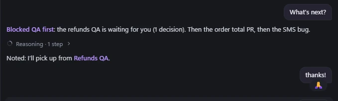
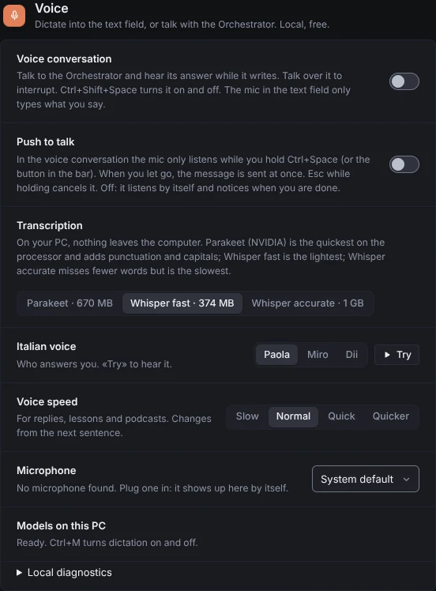
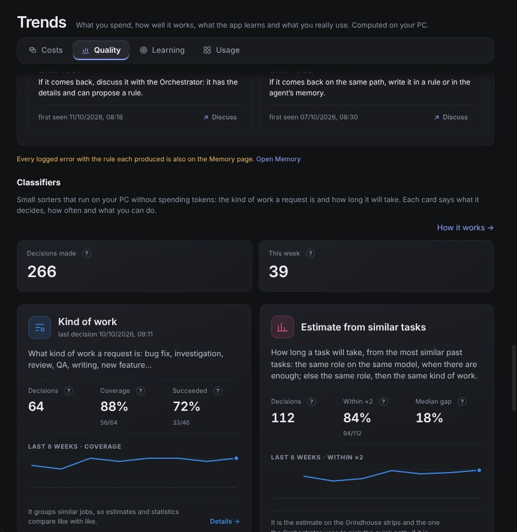

<!-- Product overview and source setup for users and contributors. Detailed operating rules live in AGENTS.md. -->
<p align="center"></p>
<h1 align="center">second-brain</h1>

### One work conversation

The Orchestrator presents worker questions, permissions, Strategist interviews and plan approvals. Worker histories
remain inspectable; their input boxes no longer compete with the Orchestrator. The first-run guide and chats started
by the user retain their reply field. Canonical outcomes appear here
automatically, with corrections updating the same result. Ask for a recap conversationally; no “Fai il punto” or
“Sintetizza” click is required. The Remote Control banner can be dismissed without disconnecting and reopened with
the phone icon. Remote Control cannot yet answer a worker request with an exact host receipt: it stays pending in
the Orchestrator desktop panel. Supported Telegram requests retain their original authenticated buttons. Outcome
messages follow the same phone policy as Orchestrator replies, including night mode and quiet hours. Historic
parent-only child reports are not replayed into the Orchestrator after upgrading.

<p align="center">
  <b>A cockpit for your AI coding agents: Claude Code, Codex, Cursor and OpenCode on one screen, with a brain that gets better every week.</b>
</p>

<p align="center">
  <a href="LICENSE"></a>
  
  
</p>


> **Full disclosure:** the developer of this app has never written a single line of its code, and has not *read* one
> either. AI agents wrote all of it, the agents reviewed it, and the agents wrote this sentence too. The developer
> mostly types wishes in Italian and drinks coffee. It works surprisingly well, which is either the point of the app or
> a warning.

## Install: don't. Let your agent do it.

Open Claude Code, Codex, Cursor or whatever agent you trust with a terminal, and paste this:

```text
Set up the second-brain desktop app for me, from source, so I can use it and also hack on it.

1. Check my machine first: git, Node.js (the version in package.json "engines", 22 or newer), npm, and the GitHub
   CLI `gh`. If something is missing, tell me what and how you would install it the normal way for my OS
   (Windows: winget; macOS: Homebrew; Linux: my package manager or nvm), and install it only after I say yes.
2. Get the code. If `gh auth status` says I'm not logged in, run `gh auth login` and let me finish it myself.
   If I can't push to lampi1/second-brain (most people can't), ask me before forking it, then clone my fork:
   `gh repo fork lampi1/second-brain --clone`; otherwise `git clone https://github.com/lampi1/second-brain.git`.
   Make sure `upstream` points to lampi1/second-brain.
3. Read AGENTS.md and CONTRIBUTING.md in the clone, and follow them from here on.
4. Install: `npm run setup` (pinned deps with install scripts off, the Electron binary, the git hooks).
   On Linux, if Electron fails to start, tell me which system libraries it asks for (e.g. libnss3, libgtk-3,
   libasound2), install them after I say yes, and try again.
5. Build and start: `npm run build`, then `npm start`. The first start opens a short setup window: I'll go
   through it myself. Then run `npm run doctor` and tell me in plain words what is still missing
   (for example: logging in to at least one of `claude`, `codex` or Cursor's `agent`, which I do myself).
6. Leave the clone ready for issues and pull requests: `gh repo view` works, `main` tracks upstream, and tell me
   the loop: a branch per change, `npm run check:quick` and a review before the merge, Conventional Commits in English,
   never `--no-verify`, the PR template in .github/. Don't push or open anything without asking me.

Finish with a three-line summary: where the code lives, how I start the app, and how I update it.
```

That's it. Updating later is one click: **Settings → Updates → Update** pulls `main`, rebuilds and restarts (or
`npm run pull` in a terminal).

## Take the tour

Meet the crew: you talk to the Orchestrator, and it hands the work to five roles (Strategist, Scout, Artisan, Sentinel,
Herald) that split it into child chats you can watch and report back.

<p align="center"></p>

### The Orchestrator and Flash

The **Orchestrator** is where work starts: it plans, hands each job to the right role, answers their mail and tells you
what is waiting. **Flash**, the tab next to it, is the "btw": a quick read-only agent on its own model that sees the
Orchestrator's conversation and answers side questions in seconds, without touching it. Use it to plan, research or
ask for advice; when the talk turns into real work, "Make it a job" has Flash write a proper brief from the whole
conversation (goal, context, what to do, constraints, done when) and drops it in the Orchestrator's input, unsent.

<p align="center"></p>

It also knows the app inside out. "Where is the spending limit?", "turn notifications off", "give the Scout the GitHub
connector", "add this MCP server": it reads the app's live map and changes the setting for you, with an Undo. Secrets
stay yours, and a server it adds stays off until you read its command and click **Activate**.

### Plan mode

On new work the Orchestrator checks for a choice that affects the outcome. The role that finds a later choice asks you directly, one yes/no panel at a time. You can type your own answer. If your choice has a concrete drawback, the role can suggest one alternative and proceeds when you confirm.

Tick **Plan** to have a Strategist turn the job into steps. The first answered intake question can travel with the assignment and counts toward the three answers. **Basta domande** ends the interview early. Approve the proposed plan in the existing panel to start delegation. The six roles’ default skills, sources and prompt costs are listed in [Skill alignment](docs/design/skills-alignment.md).

<p align="center"></p>

### Delegated work in reused worktrees

A delegated chat that writes gets its own worktree of the repository, on a fresh branch at the parent's current HEAD.
The app keeps a small pool of them per repository and reuses a free, clean one, build outputs included, instead of
checking out the whole repository again. It deletes the clean ones over your limits by itself. A worktree with
uncommitted changes or unpushed commits is never deleted: Settings → Advanced lists it, next to the limits
and the disk space each repository takes.

<p align="center"></p>

### Memory you swipe

Everything the agents learn lands as a card: a fact, a skill, a rule, a setting. Swipe right to keep it, left to drop
it (or ✓ / ✕, or the arrow keys, with Z to undo), and every card says who proposed it, in which chat and when. Behind
the deck, one hub with tabs (Approved, Skills, Rules, Ideas, Files, Statistics) under a header whose counters move
while the agents work. Scripts and saved queries belong to the skill that uses them: each skill shows its scripts,
queries, references and assets, as the Agent Skills format lays them out.

<p align="center"></p>

### Quality you can measure, a brain that tidies itself

**Quality**, a tab of **Trends**, counts the AI's mistakes instead of its compliments: errors you had to catch yourself per 100 turns, rules
that actually stopped their error (or didn't, within 14 days), PRs held by a failed build or QA, bugs that came back.
Every number says where it comes from and how many cases it covers, and "Discuss" hands it to the Orchestrator.

Then press **Maintenance** and walk away. The free part merges duplicate skills, files lessons from your corrections and
moves scripts and ideas where they belong; then an invisible agent (the strongest model, capped at $20) reads every
chat and work thread since the last Maintenance and proposes skill changes or new skills only where they are really
needed, plus improvements and app bugs. Roles never ask you about a skill change after each job. When it found something you get a little party, and every change has a reason and an Undo.

<p align="center">
  
  
</p>

### Agents that level up

Every role earns its level from verified outcomes only, never from vibes: a delegated job counts when its parent's
work checks out, and the Sentinel, the one who judges, is judged by what happens next. Each card shows the level and a
performance %. Reviews are cheap: free signals first, then a sample of finished runs reviewed together in one quiet
session on the first idle moment of the night (or after you turn the PC back on), never shown on the Grindhouse.
Engine, model and effort come from one picker, the same on the back of a card, on the Orchestrator's model chip and in
a strip's menu: search the four engines, see each model's context and effort, then say what changes: just this chat,
or the default for new chats.

<p align="center"></p>

### Emoji instead of essays

Say "thanks" and you get a 🙏, a 🎉 or a 🫡 on your message (whatever fits), not a paragraph of pleasantries. Any agent
with nothing to add reacts instead of replying, on every engine, so those tokens go to work instead.

<p align="center"></p>

### Talk to it

Two ways to use your voice:

- **Dictation.** Hit **Ctrl+M** (or the mic in the field) and speak into the Orchestrator or Flash: it types, you send.
- **Voice conversation.** Switch it on in Settings → Voice, or **Ctrl+Shift+Space**, and just talk: what you say goes
  to the Orchestrator, and its answer is read out loud sentence by sentence while it is still writing. Talk over it and
  it shuts up and listens (we wish people did that). Question cards are read to you, and a spoken "yes" or "no" counts
  as the click.

Parakeet or Whisper hears you and Piper speaks (a choice of Italian voices, at the speed you pick), all on your PC: no
audio leaves it, and it costs nothing. The app never starts talking on its own.

<p align="center">
  
  
</p>

### Automated tests in a real browser

Ask for a QA run and the agent opens your test environment in a browser tab inside the app, next to its chat: it
navigates, clicks, fills forms and takes screenshots on its own, and every step shows on its strip. The tab says which
chat is driving it, and the evidence (screenshots, the failing value) lands in the report. Here the QA agent re-ran test
case 7 and caught a refund that ignores the original discount.

<p align="center"></p>

### Calls, written down

**Record call** grabs your mic and the PC's audio (Teams, Meet, whatever), and Whisper writes the transcript locally,
"You" and "Others", at zero tokens. Later you just tell the Orchestrator "open a bug from this morning's call".

<p align="center"></p>

### The brain map

Notes, chats, agents and tools as a 3D map you can spin, glowing along the links where the work is happening right now.

<p align="center"></p>

### Trends: the numbers in one place

**Trends** puts the statistics on one page with tabs: **Costs** (where the money went, which chat's context is getting
heavy), **Quality** (with the classifiers), **Learning** and **Usage**. Usage counts which pages and actions you really
open, on your PC only, so deciding what to keep rests on numbers, not guesses.

<p align="center"></p>

### Classifiers: small decisions, zero tokens

Not everything needs a model. Small sorters on your PC decide the kind of work, how long and how much a job will
probably take, and which mail the Orchestrator reads now or later; the model itself is simply the one on the agent's
card. The Classifiers section of Quality shows each sorter as a card: how many decisions, how often it got them right,
how many of those chats succeeded (only verified ones count), the last 8 weeks, and what you could change.

<p align="center"></p>

### Learn what your agents built

The agents wrote the code; now you want to understand it. **Learn** has one field: paste a PR link, a concept or a long
text, drop in files or folders, and it explains it piece by piece on a blackboard: flowcharts, sequence and state
diagrams, timelines, mind maps, highlighted code, formulas and charts that grow as you go, out loud if you like. Your
files can drive a web search for the public standards and libraries they use (only filtered public terms leave your PC,
shown as chips). By default a lesson is an **Explanation**: a picture for every piece, a short caption (the full text
one click away), before/after diagrams side by side, and no questions at all; explaining it back at the end is a button
you may press, never a test. Pick **Quiz** to be tested instead: quizzes of several kinds (choice, true or false,
complete the code, put in order) to see if it stuck, a score that tells you honestly what you still remember, review
cards (an Explanation leaves none, unless you open the Studio's flashcards or quiz yourself). "Explain it better", "Give me an example" or "Show me the code" when you're lost. A quality check rewrites weak
pieces before you see them, and every lesson is saved and reopens where you left it.

<p align="center"></p>

### Stay current with the AI news

**Learn** opens on the **News** tab: a short AI newspaper made for someone who builds agents. One click on **Refresh**
reads about 28 chosen sources (lab blogs and release notes, model and benchmark trackers, Claude Code, Codex, Cursor
and other harness changelogs, the MCP and Agent Skills specs, a few researchers' newsletters, Hacker News and Hugging
Face Papers for what the list misses) at zero tokens, merges the same story told by several sources, ranks the paper
by recency, source, relevance to your work and echo, and then one AI pass writes a short summary and "why it matters
to you" for the best 30. Every story keeps its links; the head shows what that refresh cost in tokens. Three columns
(sections, stories, the open story) with keys (J/K, S save, U read, E learn it, O open the source); **Learn** on a
story or on one of your PRs (the **Pull requests** tab, same layout) starts the usual lesson. **Sources** lets you
pause, remove or add one by pasting its link, with each source's last reading or error; a daily refresh is there, off
by default, with its estimated cost. The sources and why each was picked: `docs/adr/0264-impara-ai-newspaper.md`.

<p align="center"></p>

### Nothing happens off the record

The **Log** shows everything the app did, live: who chose whom, what it cost, which answer was a duplicate. **Costs**
in Trends tells you where the money went and which chat's context is getting heavy. Both read local data and spend
zero tokens.

<p align="center">
  
  
</p>

### Routines, run from the terminal

Prepare a routine package with the Orchestrator, export it, and run it anywhere with `routine run`, `watch` or
`resume`. The app never runs routines by itself: it just shows a run's steps, screenshots and evidence when you open it.
How-to: [packages/routine-runtime](packages/routine-runtime/README.md).

### Lost? There's a guide

Every concept of the app as a card: how it works, an everyday analogy, the source files. **Discuss** sends the card to
the Orchestrator to explain it your way.

## Also on board

- **Answer with one key.** Questions and permissions show up as cards in one window, with an estimate before and a
  verdict after. OpenCode and Cursor stay once-only: remembered upstream grants could skip later app permission
  checks. OpenCode starts with the app's permission rules instead: what your Claude settings deny stays denied whatever
  OpenCode's own config says, and every command goes through the app's check. No global CLI settings are changed.
- **Your rules, not the app's.** Agents may do everything by default. What stops them is a `permissions.json` file in
  your brain: a rule holds a command for your Esegui click, asks you (from the phone too), or forbids printing a secret.
  After a refusal the agent goes on with the rest. No file: everything is free (ADR 0254).
- **Settings that find themselves.** One page with a section list, search that highlights the matching row, instant
  save with Undo.
- **Connectors in one paste.** Paste a README's JSON, a command line or a URL and the MCP server is ready; switch it on
  per role. The Orchestrator can set one up for you too.
- **More ACP agents, your call.** Settings → Accounts and tools proposes known ACP CLIs (Grok Build, Devin, Droid,
  Kilo Code, Cline and more), all off. Install one and sign in yourself, then "Turn on" makes it an engine like the
  others; the app never installs or signs in.
- **The Orchestrator on your phone.** Settings → Phone links a private Telegram bot of yours: write or send a voice
  note from the phone and answer simple yes/no questions with a button, and the permissions your brain's rules send
  you. Other permissions and commands still wait for the PC, and the bot token is encrypted and never shown again.
- **Continue the Orchestrator at claude.ai.** The phone icon on the Orchestrator turns on Claude Code Remote Control:
  open the link it shows in the Claude app or a browser and keep going from there. What you type on the phone shows in
  the app marked «dal telefono», and the link survives an app restart.
- **Tasks.** The Task page lists your Azure DevOps work items and PRs, with builds, votes and QA results.
- **Copy any file.** The copy icon in the file viewer puts the file on the clipboard: its text, the image, or the file
  itself.
- **A brain in plain Markdown.** Notes, rules, skills and scripts live in a folder you own, readable without the app.
- **Your own logins.** It drives the official CLIs with your account and never touches their settings. The UI speaks
  Italian, English and German.

## The rest

Everything else lives where agents (and the occasional human) can find it: [AGENTS.md](AGENTS.md) for the rules and
commands, [CONTRIBUTING.md](CONTRIBUTING.md) for the workflow, [docs/architecture.md](docs/architecture.md) and
[docs/adr/](docs/adr/) for the why, [CHANGELOG.md](CHANGELOG.md) for the what. Just the brain, without the app:
`node brain-template/install.mjs`.

Use it at your own risk: agents run commands on your machine with the permissions you give them, so read what they
propose before you approve it. Check the Anthropic, OpenAI and Cursor terms before you use it with a subscription.

## License

[MIT](LICENSE)
