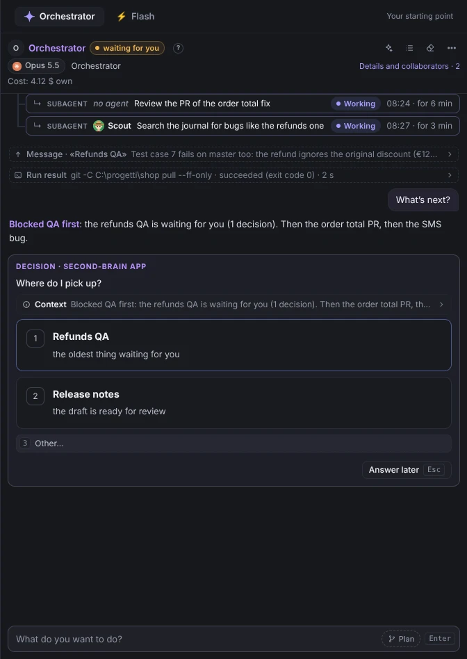
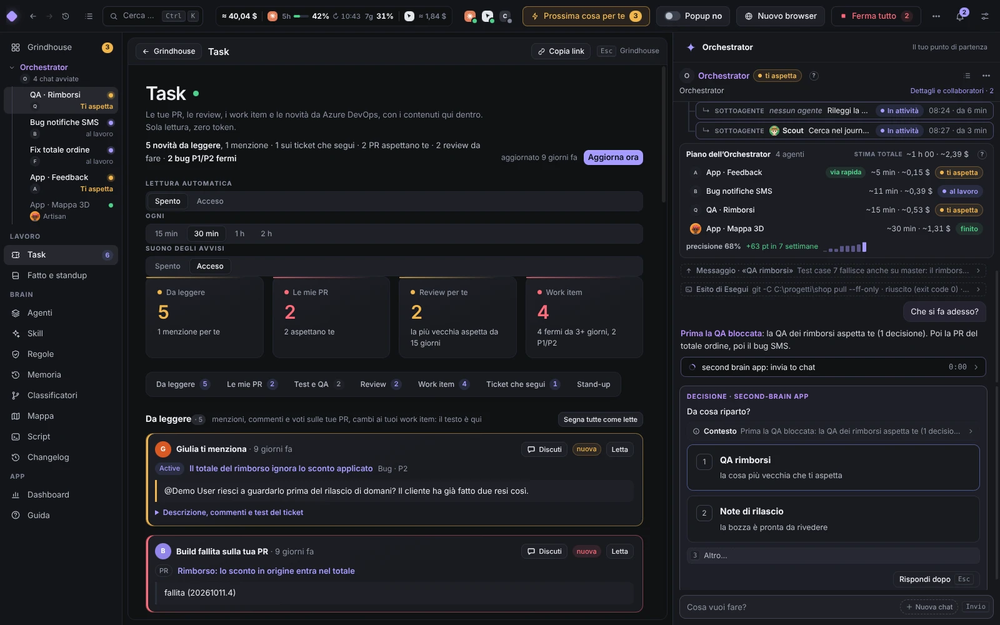
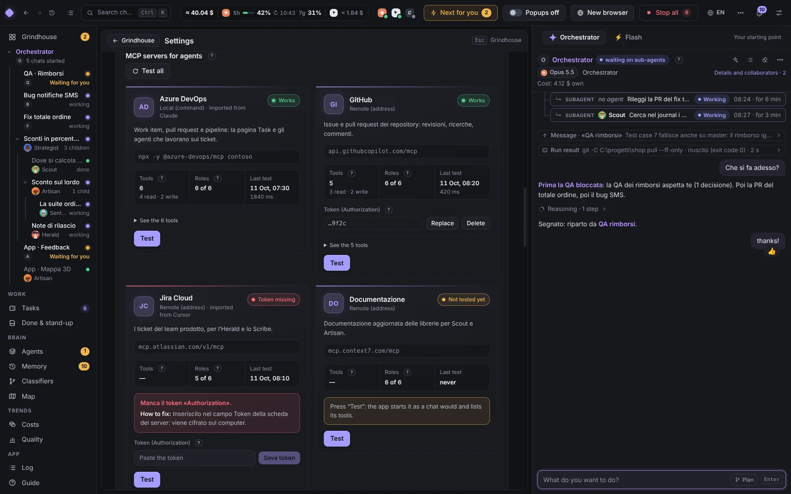
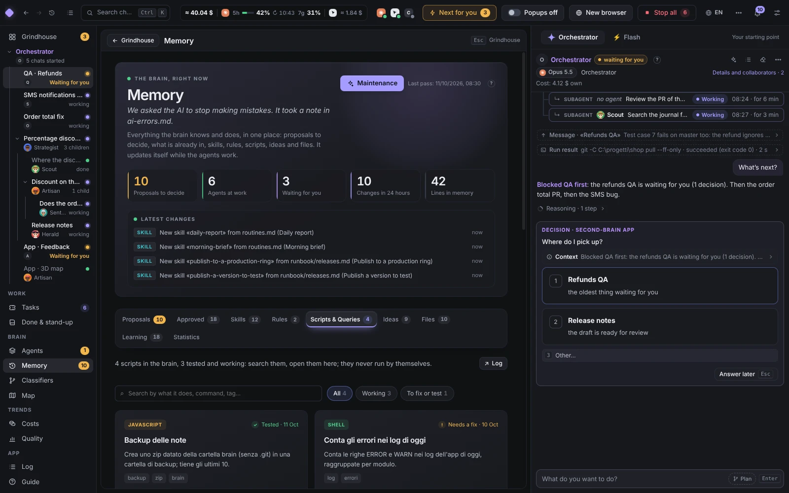

<p align="center">
  
</p>

<h1 align="center">second-brain</h1>

<p align="center">
  <b>Your AI coding agents, as a crew. You, as the boss.</b><br>
  Claude Code, Codex and Cursor agents that plan, delegate, drive browsers and report back,<br>
  all on one screen, with a second brain that makes them better every week.
</p>

<p align="center">
  <a href="#try-it-in-2-minutes"><b>Try the demo</b></a> ·
  <a href="#run-it-for-real"><b>Run it for real</b></a> ·
  <a href="#download"><b>Download</b></a> ·
  <a href="#update"><b>Update</b></a> ·
  <a href="CONTRIBUTING.md"><b>Contribute</b></a>
</p>

<p align="center">
  
  
  
  
  
</p>


Five agents at once and the bottleneck is no longer the model: it is you. Who is waiting on you? Who is burning tokens
in a loop? What did the QA agent see in its browser? **second-brain** puts the whole crew on one screen, so your
attention goes where it is needed and nowhere else.

It drives the **official** CLIs (`claude`, `codex`, Cursor's `agent`) with **your own** login and never touches their
settings. The interface speaks Italian and English.

## Why you'll like it

**🌳 Work as a tree, not a pile of tabs.** You tell the Orchestrator what you want. It hands the job to a role, the role
splits it into child chats, and the Grindhouse shows the whole family as thread cards: who is on it, what they found,
what they still owe. A child's question goes to its parent first; only what truly needs you reaches you, once.

**🎭 A crew with characters.** The Orchestrator and five work roles, each with its own face, job, skills and model
tier (ADR 0100):

<p align="center"></p>

<p align="center"><sub><b>Orchestrator</b> conducts · <b>Strategist</b> plans · <b>Scout</b> explores · <b>Artisan</b> builds and writes · <b>Sentinel</b> tests and reviews · <b>Herald</b> announces</sub></p>

**⌨️ Answer with one key.** Questions and permissions pop up as panels right in the agent's strip, with the context the
agent had when it asked. Every job gets an estimate up front ("~4 min · ~0,12 $ · from 12 similar tasks") and a
verdict at the end ("~4 min → 6 min ✓").

**⚡ Flash, for quick questions.** A second tab beside the Orchestrator answers in seconds with read-only tools: it
explains, reads and searches, and changes nothing. Like a "btw" it sees the Orchestrator's conversation, so you can
ask about the work in progress (ADR 0106). It is an agent with its own card and model; both columns show their model
in the header and change it with a click (ADR 0107). When the answer turns into work, **Fanne un lavoro** hands it to
the Orchestrator (ADR 0105).

**✅ Outcomes with their evidence.** Completed work, the agent's own assessment, no observed corrections and an
independent verdict are different signals. Only a human verdict or an evidence-based review counts as verified
success. A follow-up is a new run, not a correction. Classifiers show their coverage and explain missing data;
seven days of silence never become proof of correctness (ADR 0110).

**↪️ Keep the conversation.** A related Scout follow-up can stay in the same conversation and project while opening
a new, versioned assignment and measured run. A changed role or project, and an independent Sentinel review,
start fresh. The Orchestrator's **Plan** button starts a Strategist, which asks material questions before planning.
Plans collapse to a compact progress row; finished execution and partial result quality are shown separately.

**📬 Read the actual result.** The complete report and its criterion evidence are saved with the exact task and run.
Expand it directly in the Orchestrator without another AI turn. Pending delivery survives restart and retries;
child reports still reach their parent for integration. Reading a report costs no model inference; synthesis does.

**📈 Agents that level up, honestly.** A role's level is the number of its verified successes: «Lv 6 Maestro · 38
riusciti verificati». The app tunes models, instructions and skills by itself, as a trial against the old version,
and keeps a change only when a confidence interval says it is better (Wilson, Newcombe; ADR 0104). Every change has
an "Annulla".

**☀️ An app that tells you what happened.** Each strip says what its agent is doing right now. When you come back, a
morning block lists what finished, what waits for you, red builds and yesterday's spend, built from what the app
already knows, at zero tokens (ADR 0102).

**↩️ Undo a turn.** Before each turn the app records the folder's files in a hidden git ref; «Annulla l'ultimo turno»
puts them back, without touching your index or branches (ADR 0103).

**🧠 A brain that remembers its sources.** Notes and scripts remain readable files. Structured memory records carry
project scope, source run, date and status; a proposed replacement cannot silently erase a confirmed fact. Legacy
notes stay intact and unverified. Recall selects relevant scoped facts within a budget, alongside the existing
hybrid search. Repeated tasks produce skill candidates for review and replay, never automatically active skills.
Watch the brain live on a 3D map, lit where the crew is working right now.

Costs are API-equivalent estimates where the engine supplies usage, not subscription invoices. Token/cache counts,
work duration, result delivery and independent outcome coverage describe different parts of the same run. Missing
measurements remain unknown; a comparison across different tasks is not evidence that an automatic change helped.
Delivery statistics show coverage and report-to-notice latency for retained results; synthesis counts observed
engine submissions, not completed AI turns. Historical results without delivery observations remain unknown.

In **Brain → Memoria**, review each proposed fact with its source and scope, confirm it with evidence, retract it,
or delete its stored value and app-managed derived copies. A date filter shows historical validity; historical
views are read-only. A failed search invalidation remains pending across restart and blocks stale search results
until it succeeds. Source conversations are separate records and are not silently erased by a memory action.

The same page contains **evaluation and skill candidates**. Import explicitly anonymized cases with separate
`tuning` and `holdout` groups. The built-in examples are synthetic workflow fixtures, not measured product
performance. Starting a replay is an explicit action that spends the configured engines' tokens: each case gets
a fresh measured role run and an independent Sentinel review. An interrupted replay never resumes paid work
automatically. Compare retained paired cases by independently verified quality, turns, tokens, cache usage and
estimated cost; unavailable measurements stay unknown and review costs are shown as excluded from task cost.

A candidate remains outside active skills. Inspect and save concrete steps, verify an original example, then run
an anonymized holdout replay of that exact draft. **Promote this version** is enabled only when those checks pass;
synthetic examples, tuning cases and model self-reports cannot qualify. Promotion is recorded in the existing
change log with rollback. A new brain starts without qualifying evidence; the UI explains what is missing.

Task assignments retain their goal, criteria and version. **Continue here** focuses the same conversation;
**Ask the Orchestrator** prepares a draft with stable task/run references. Complete ordered user decisions are
available through `app_task_events`; stale assignment cursors are refused. Delivery policy is explicit:
`display` shows the full result, `notify` adds quiet news, and `synthesize` requests an AI integration turn.
**Synthesize with the Orchestrator** is a separate user action; queued delivery remains visible until submission.

## A quick tour

<table>
<tr>
<td width="50%"><br><b>The Orchestrator.</b> One chat that plans, delegates, routes mail between agents and tells you what needs you.</td>
<td width="50%"><br><b>Agenti.</b> Every role as a card: level, performance, runs, cost, and a "?" with the formula behind each number.</td>
</tr>
<tr>
<td><br><b>Browsers they drive.</b> Real tabs inside the app over MCP: click, type, read, screenshot. Passwords and MFA are always yours.</td>
<td><br><b>The brain map.</b> Notes, agents and tools in 3D, glowing where the work happens.</td>
</tr>
<tr>
<td><br><b>Task.</b> Mentions, PRs, reviews and work items from Azure DevOps, read only and at zero tokens. <b>Discuti</b> hands any of them to the Orchestrator.</td>
<td><br><b>Connettori.</b> Add an MCP server once and every engine gets it. Tokens stay encrypted and you choose which roles may use it.</td>
</tr>
<tr>
<td><br><b>Scripts.</b> The tools your agents wrote and tested, reusable by every chat, with every change in the changelog.</td>
<td><br><b>Qualità.</b> Errors you had to catch, rules that did not stick, PRs held back, each measured from real logs.</td>
</tr>
</table>

Faster and cheaper by design (ADR 0099): engines prewarmed for the next chat, rules hooks answered in process, clean
results batched into one Orchestrator turn, and browser reads that return only what changed.

Also on board: cloud agents (Cursor, Codex, Claude Code) next to the local ones, one-click **Esegui** for shell blocks,
long chats handed off before the context fills, Ctrl+K search across everything, an in-app **Guida**, and an
app-control MCP server so agents can see and drive the app itself.

## Try it in 2 minutes

No CLI, no login, no tokens: the demo runs the whole interface on fictional data.

```powershell
git clone https://github.com/lampi1/second-brain.git
cd second-brain
npm run setup      # pinned dependencies (install scripts off) + the Electron binary + the git hooks
npm run demo       # builds and opens the app with a demo crew, browser tabs and a sample brain
```

You need [Node.js](https://nodejs.org) 22+ and [Git](https://git-scm.com). Windows 10/11 is the tested platform;
Linux and macOS are built for but not yet tried on a real machine (ADR 0054).

## Run it for real

```powershell
npm run build      # main + preload with esbuild, the interface with Vite → out/
npm start          # first start: one setup window, seven short steps
```

Install and log in to at least one CLI yourself: [Claude Code](https://docs.anthropic.com/en/docs/claude-code)
(`claude`), Codex (`codex`) or the Cursor CLI (`agent`). The app never asks for your passwords. The setup finds your
projects folder, connects your AI and tools (GitHub, Azure DevOps, Jira) with a real read-only check, and starts an
empty brain or opens yours. `npm run doctor` tells you what is still missing.

Want to change the app? `npm run dev`, then `npm run check:branch` before you commit. Start with
[CONTRIBUTING.md](CONTRIBUTING.md); AI agents read [AGENTS.md](AGENTS.md).

## Download

| Version | Date | Windows installer | Source code |
| --- | --- | --- | --- |
| **0.1.0** (latest) | 2026-10-13 | coming with the published release | [zip](https://github.com/lampi1/second-brain/archive/refs/tags/v0.1.0.zip) · [tar.gz](https://github.com/lampi1/second-brain/archive/refs/tags/v0.1.0.tar.gz) |

The Windows installer is one offline, per-user `.exe` (no Node.js, Git or admin rights), with a `.sha256` next to it.
It is not code-signed yet, so SmartScreen may ask once ("More info" → "Run anyway"). Every version:
[releases](https://github.com/lampi1/second-brain/releases) · [CHANGELOG.md](CHANGELOG.md).

## Only the brain, without the app

The brain is a folder of Markdown files with an `AGENTS.md` index, so Claude Code, Cursor and Codex can use it on their
own (ADR 0088). From GitHub: download this repository and run `node brain-template/install.mjs` (Node.js 22+); it asks
your name and a folder and writes an empty brain with its skills. From a colleague: in the app, Settings → Il mio
spazio → "Condividi il brain" zips the rules, skills, roles and scripts, never your memory.

## Update

From a clone: **Impostazioni → Aggiornamenti → Aggiorna** pulls `main`, rebuilds and restarts in one click. It only
fast-forwards, so your local work is never touched. From a terminal: `npm run pull`. With the installer: download the
newer one from [Releases](https://github.com/lampi1/second-brain/releases); your brain, chats and settings stay where
they are. Your stable copy (ADR 0007) goes back by itself if a new version does not open; `npm run rollback` by hand.

## Safe by design

- Electron locked down: `contextIsolation`, `sandbox`, no `nodeIntegration`, strict CSP, every IPC call checked.
- The MCP server listens on 127.0.0.1 only; browser tabs live in their own partition.
- Each CLI owns its login. Keys and MCP tokens are encrypted with the OS secret store and reach only their own engine or
  server, never a chat, a file or a log (ADR 0046, 0086).
- No production access is wired in. Dependencies are pinned, well known and at least 14 days old; a git hook scans
  every commit for secrets before it leaves your PC.

Under the hood: [docs/architecture.md](docs/architecture.md) · every decision in [docs/adr/](docs/adr/) · releasing:
[docs/windows-installer.md](docs/windows-installer.md).

## Roadmap

- Linux and macOS proved on real machines; signed installers.
- More connectors (issue trackers beyond Azure DevOps); MCP servers that sign in with OAuth.
- Team features: hand a to-do to a colleague, a shared team layer next to each person's brain.

## Limits

- **Use at your own risk.** A personal project, provided as is, without warranty (see [LICENSE](LICENSE)). Agents run
  commands on your machine with the permissions you give them: read what they propose before you approve it.
- **Logins and terms of service.** The app only drives the CLIs you installed and logged into yourself, for your own
  use. Anthropic's terms do not allow third-party products to offer Claude.ai (subscription) login to their users:
  check the current Anthropic, OpenAI and Cursor terms before you use it with a subscription, give it to others or
  build on it.
- **Each engine spends only its own tokens**: a Claude chat never starts Cursor and vice versa.

## License

[MIT](LICENSE)
