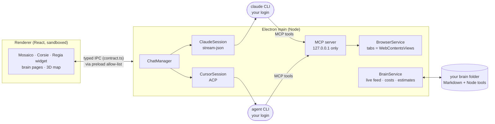

<p align="center">
  
</p>

<h1 align="center">second-brain</h1>

<p align="center">
  <b>One desktop cockpit for all your AI coding agents.</b><br>
  Run Claude Code and Cursor chats side by side, answer every question they ask from one place,<br>
  watch the browsers they drive, and keep a second brain that makes them better every week.
</p>

<p align="center">
  
  
  
  
</p>


When you work with five agents at once, the bottleneck is no longer the model: it is you. Which chat is waiting on
you? Which one is burning tokens in a loop? What did the QA agent see in its browser? second-brain puts every chat,
question, browser and ticket on one screen, so you spend your attention where it is needed and nowhere else.

It does not replace the agents: it starts the **official** `claude` and `agent` (Cursor) CLIs with **your own** login,
and it never touches their settings. Close Claude desktop and Cursor, or keep them open next to it.

> The user interface is in Italian today (it started as one developer's daily tool). Code, comments, docs and commits
> are in English, and an English UI is on the roadmap.

## Try it in 2 minutes

No CLI, no login, no tokens: the demo runs the whole UI on fictional data.

```powershell
git clone https://github.com/lampi1/second-brain.git
cd second-brain
npm run setup      # npm ci (scripts off) + the Electron binary
npm run demo       # builds and opens the app with demo chats, browser tabs and a sample brain
```

Requirements: Windows 10/11 (Linux and macOS: built for, not yet tried on a real machine, ADR 0054), [Node.js](https://nodejs.org) 22+, Git.
On macOS and Linux, "Esegui" runs commands in your login shell instead of PowerShell, and the stable app starts from
`launch.sh` (a `second-brain.command` on the macOS desktop, a menu entry on Linux).

## Features

### Chats as tiles, questions as panels

Every Claude Code or Cursor chat is a tile with its streaming text, tool calls, diffs, cost and context size. When an
agent asks a question or a permission, it shows up as a panel right in its tile (or in a floating layer, wherever you
are in the app): answer with one key, with the context the agent had when it asked. Two views: **Mosaico** (free
tiles) and **Corsie** (columns: waiting for you, working, done).

### The Regia: a chat that coordinates the others


The Regia ("director") is the chat you talk to first. It knows every open chat, opens new ones for you, routes mail
between them and tells you what to do next. Docked bottom-right, it never covers your work; you can run several, one
per project.

### Browsers your agents drive


Agents get real browser tabs inside the app through a local MCP server: navigate, click, type, read the page, take
screenshots, with trusted input like a real user. Each tab sits next to the chat that owns it. Logins persist per
environment, and when a page needs a password, MFA or a CAPTCHA the agent hands it over to you: the app never types
your passwords.

### A live map of your brain


Your brain is a folder of Markdown notes and small Node tools that the agents read and write: open threads, journal,
ideas, the errors they made and the rules learned from them. The app shows it as pages (today, to-do, ideas, explore)
and as a 3D map that lights up the files, tools and chats at work right now.

### DevOps in one page


Mentions, comments and votes on your pull requests, reviews waiting for you, stuck work items, failed builds and the QA
status of each pull request, read on demand from Azure DevOps by a script of your brain (zero tokens, read only). Every
item opens its chat in one click.

### Quality you can measure


Four metrics computed from real logs, each with its source and the days it covers: errors you had to catch yourself
per 100 turns, rules that did not stop their error, pull requests held by QA or builds, bugs reopened after a fix.
Costs, budgets and estimates per chat and per day sit next to them.

### And more

- **Esegui**: shell blocks in a chat run with one click, and the output goes back to the chat.
- **Long chats** are handed off before the context fills: a note, then "Riprendi" in a fresh chat.
- **Model routing**: a versioned table picks harness, model and effort per kind of task.
- **Full-text search** (Ctrl+K) across chats, browser tabs, pages and commands.
- **Migliora l'app**: the app's own Regia improves the app on branches; you promote a tested build with one click and
  can roll back.
- **Agent-friendly by design**: an app-control MCP server lets agents read the app state, screenshot it and drive it.

## Use it with your agents

1. Install and log in to at least one harness yourself: [Claude Code](https://docs.anthropic.com/en/docs/claude-code)
   (`claude`) and/or the Cursor CLI (`agent`).
2. Create your brain from the template in `brain-template/`: `node brain-template/install.mjs` (its questions are in
   Italian today; answer `s` for yes). It asks before touching anything in your home folder and backs up every file it
   changes.
3. `npm run build`, then `npm start`, and pick your brain folder in the settings.

`npm run doctor -- --dev` tells you what is missing (Electron, build, CLIs, logins, brain, MCP port); without `--dev`
it checks a promoted stable release.

## Architecture



One contract (`src/shared/contract.ts`) defines every data shape and IPC channel; main, preload and renderer follow it.
Details: [docs/architecture.md](docs/architecture.md); every decision: [docs/adr/](docs/adr/).

## Security model

- Electron baseline, never relaxed: `contextIsolation`, `sandbox`, no `nodeIntegration`, a strict CSP, every IPC call
  checked against its sender, preload exposes only an allow-listed `window.sb`.
- The MCP server listens on 127.0.0.1 only, with Host/Origin checks and a per-chat token: each chat sees only its own
  browser tabs.
- Browser tabs live in their own partition, apart from the app.
- No credentials in the app: each CLI logs in by itself, agents never type a password on a remote host, nothing secret
  in files or logs.
- No production access is wired in: no database, deploy or write-cloud commands.
- Dependencies: exact versions, well-known packages, published at least 14 days before they are installed; npm install
  scripts are off (`.npmrc`).

## Development

```powershell
npm run dev            # dev build + run (SB_HIDDEN=1 keeps the window off screen, for agents)
npm run check:branch   # what a branch needs: typecheck, lint, related unit tests, e2e of the touched area
npm run check          # everything (typecheck, lint, all unit tests, all e2e), on main
npm run shots          # regenerate the README screenshots from the frozen demo
```

Start with [CONTRIBUTING.md](CONTRIBUTING.md) (workflow, contract-first features, tests, ADRs, a map of the modules).
AI agents working on the repo read [AGENTS.md](AGENTS.md).

## Roadmap

- English UI (the strings are Italian today).
- Linux and macOS proved on real machines (CI runs them on GitHub's runners, ADR 0054); installers (.dmg, .AppImage) with
  signing.
- More connectors behind the same interface (issue trackers beyond Azure DevOps).
- Team features: handing a to-do to a colleague, a shared team layer next to each person's brain.

## Limits

- **Use at your own risk.** A personal project, provided as is, without warranty (see [LICENSE](LICENSE)). Agents run
  commands on your machine with the permissions you give them: read what they propose before you approve it.
- **Logins and terms of service.** The app only drives the CLIs you installed and logged into yourself, for your own
  use. Anthropic's terms do not allow third-party products to offer Claude.ai (subscription) login to their users:
  check the current Anthropic and Cursor terms before you use it with a subscription, give it to others or build on it.
- **Each harness spends only its own tokens**: a Claude chat never starts Cursor and vice versa.

## License

[MIT](LICENSE)
