<!-- Product overview and source setup for users and contributors. Detailed operating rules live in AGENTS.md. -->
<p align="center"></p>
<h1 align="center">second-brain</h1>

<p align="center">
  <b>A cockpit for your AI coding agents: Claude Code, Codex and Cursor on one screen, with a brain that gets better every week.</b>
</p>

<p align="center">
  <a href="LICENSE"></a>
  
  
</p>

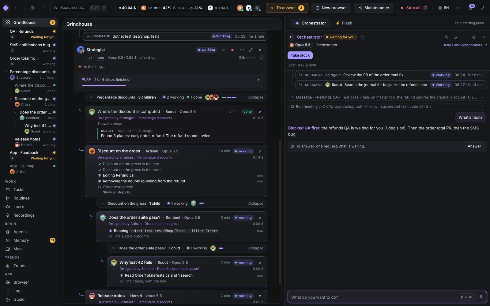

> **Full disclosure:** the developer of this app has never written a single line of its code, and has not *read* one
> either. AI agents wrote all of it, the agents reviewed it, and the agents wrote this sentence too. The developer
> mostly types wishes in Italian and drinks coffee. It works surprisingly well, which is either the point of the app or
> a warning.

## Install: don't. Let your agent do it.

Open Claude Code, Codex, Cursor or whatever agent you trust with a terminal, and paste this:

```text
Set up the second-brain desktop app for me, from source, so I can use it and also hack on it.

1. Check my machine first: git, Node.js (the version in package.json "engines", 22 or newer), npm, and the GitHub
   CLI `gh`. If something is missing, tell me what and how you would install it the normal way for my OS
   (Windows: winget; macOS: Homebrew; Linux: my package manager or nvm), and install it only after I say yes.
2. Get the code. If `gh auth status` says I'm not logged in, run `gh auth login` and let me finish it myself.
   If I can't push to lampi1/second-brain (most people can't), ask me before forking it, then clone my fork:
   `gh repo fork lampi1/second-brain --clone`; otherwise `git clone https://github.com/lampi1/second-brain.git`.
   Make sure `upstream` points to lampi1/second-brain.
3. Read AGENTS.md and CONTRIBUTING.md in the clone, and follow them from here on.
4. Install: `npm run setup` (pinned deps with install scripts off, the Electron binary, the git hooks).
   On Linux, if Electron fails to start, tell me which system libraries it asks for (e.g. libnss3, libgtk-3,
   libasound2), install them after I say yes, and try again.
5. Build and start: `npm run build`, then `npm start`. The first start opens a short setup window: I'll go
   through it myself. Then run `npm run doctor` and tell me in plain words what is still missing
   (for example: logging in to at least one of `claude`, `codex` or Cursor's `agent`, which I do myself).
6. Leave the clone ready for issues and pull requests: `gh repo view` works, `main` tracks upstream, and tell me
   the loop: a branch per change, `npm run check:branch` before committing, Conventional Commits in English,
   never `--no-verify`, the PR template in .github/. Don't push or open anything without asking me.

Finish with a three-line summary: where the code lives, how I start the app, and how I update it.
```

That's it. Updating later is one click: **Settings → Updates → Update** pulls `main`, rebuilds and restarts (or
`npm run pull` in a terminal).

## Take the tour

Meet the crew: you talk to the Orchestrator, and it hands the work to five roles (Strategist, Scout, Artisan, Sentinel,
Herald) that split it into child chats you can watch and report back.

<p align="center"></p>

### The Orchestrator and Flash

The **Orchestrator** is where work starts: it plans, hands each job to the right role, answers their mail and tells you
what is waiting. **Flash**, the tab next to it, is the "btw": a quick read-only agent on its own model that sees the
Orchestrator's conversation and answers side questions in seconds, without touching it. When a question turns into
real work, "Make it a job" drafts it for the Orchestrator.

<p align="center">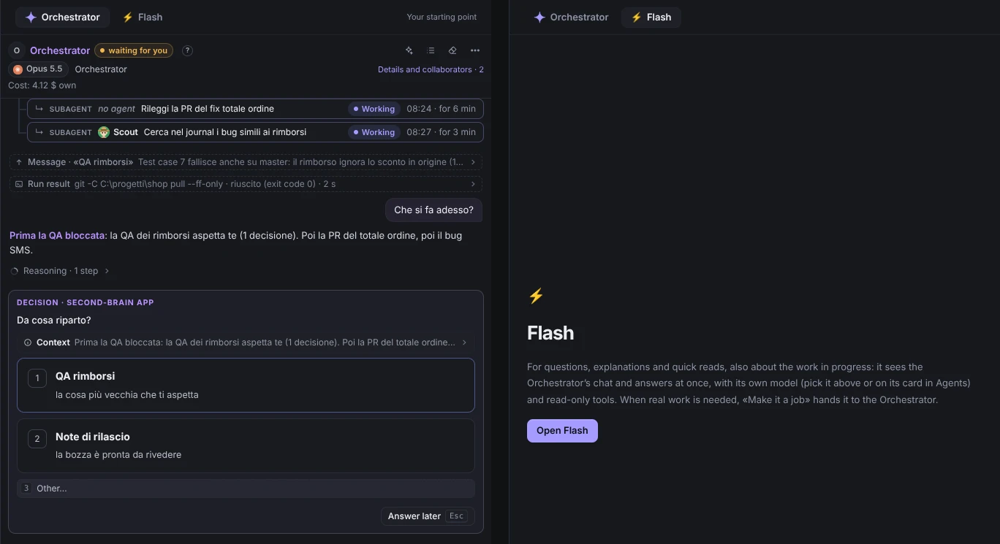</p>

It also knows the app inside out. "Where is the spending limit?", "turn notifications off", "give the Scout the GitHub
connector": it reads the app's live map and changes the setting for you, with an Undo. Secrets stay yours.

### Plan mode

Tick **Plan** and a Strategist takes the job: it asks you a few questions first, then proposes a short plan, each step
with the role that will do it. You approve it in the questions window, and only then does it start the other agents,
as the tree of thread cards at the top of this page, its steps ticking off on its strip.

<p align="center">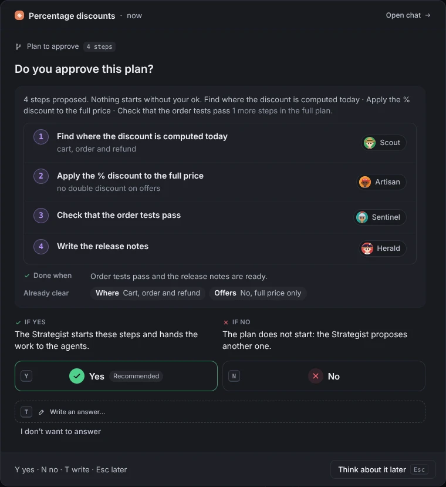</p>

### Memory you swipe

Everything the agents learn lands as a card: a fact, a skill, a rule, a setting. Swipe right to keep it, left to drop
it (or ✓ / ✕, or the arrow keys, with Z to undo), and every card says who proposed it, in which chat and when. Behind
the deck, one hub with tabs (Approved, Skills, Rules, Scripts & Queries, Ideas, Files, Learning, Statistics) under a
header whose counters move while the agents work.

<p align="center">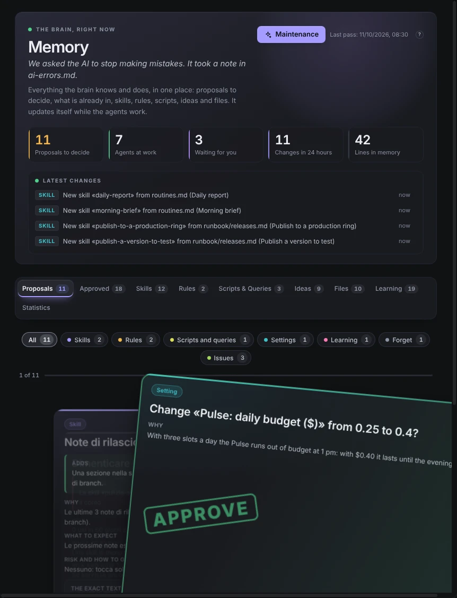</p>

### Maintenance: one button, a tidy brain

Press **Maintenance** and walk away. The free part merges duplicate skills, files lessons from your corrections and
moves scripts and ideas where they belong; then an invisible agent (capped at $5) looks for improvements and app
bugs. When it found something you get a little party, and every change has a reason and an Undo.

<p align="center">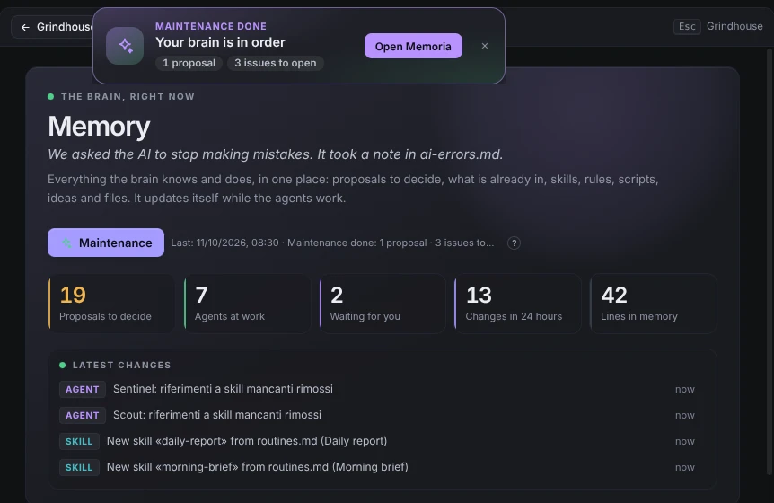</p>

### Agents that level up

Every role earns its level from verified outcomes only, never from vibes: a delegated job counts when its parent's
work checks out, and the Sentinel, the one who judges, is judged by what happens next. Each card shows the level and a
performance %.

<p align="center">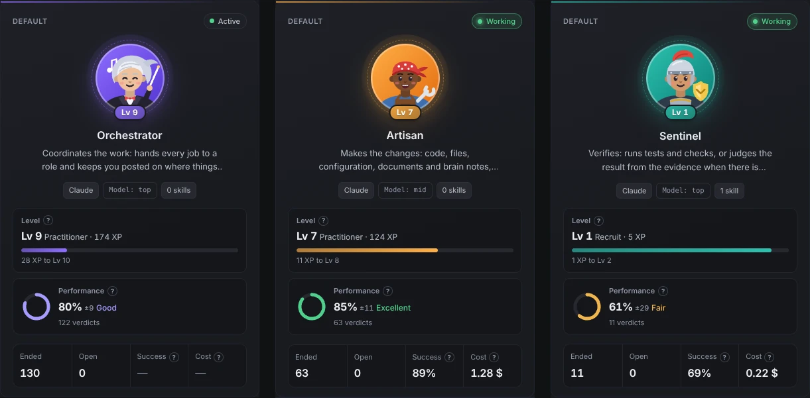</p>

### Emoji instead of essays

Say "thanks" and you get a 👍 on your message, not a paragraph of pleasantries. Any agent with nothing to add reacts
instead of replying, on every engine, so those tokens go to work instead.

<p align="center">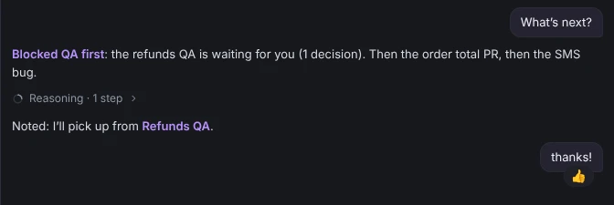</p>

### Talk to it

Hit **Ctrl+M** and dictate into the Orchestrator or Flash. Switch on the voice conversation and it answers out loud,
sentence by sentence while it writes; talk over it and it shuts up and listens (we wish people did that). Questions are
read to you and "yes" counts as a click. Whisper and Piper run on your PC: no audio leaves it.

<p align="center">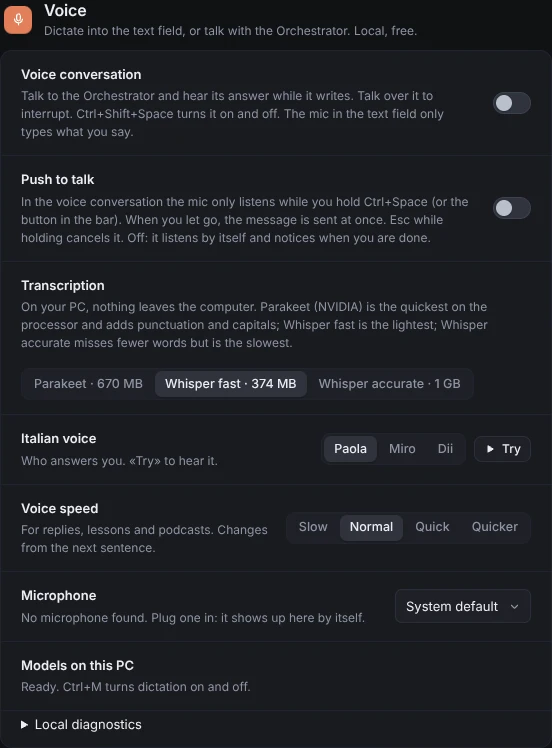</p>

### Calls, written down

**Record call** grabs your mic and the PC's audio (Teams, Meet, whatever), and Whisper writes the transcript locally,
"You" and "Others", at zero tokens. Later you just tell the Orchestrator "open a bug from this morning's call".

<p align="center">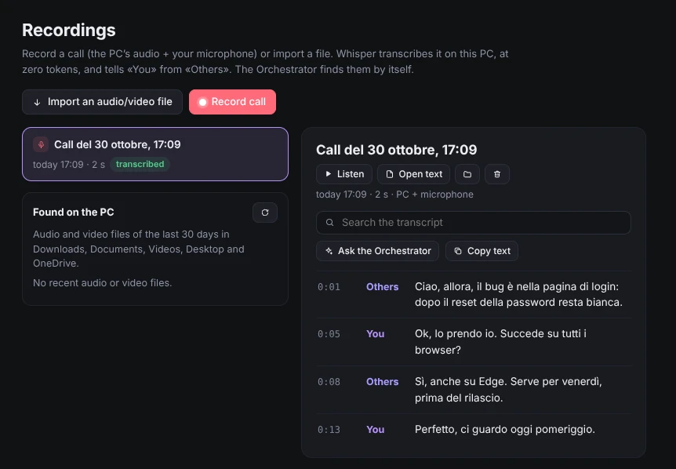</p>

### The brain map

Notes, chats, agents and tools as a 3D map you can spin, glowing along the links where the work is happening right now.

<p align="center"></p>

### Nothing happens off the record

The **Log** shows everything the app did, live: who chose whom, what it cost, which answer was a duplicate. **Costs**
tells you where the money went and which chat's context is getting heavy. Both read local data and spend zero tokens.

<p align="center">
  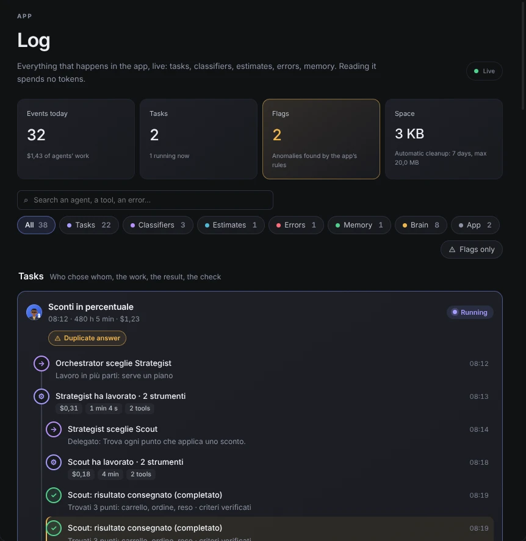
  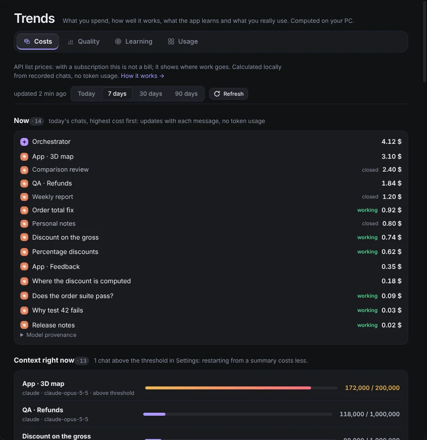
</p>

### Routines, run from the terminal

Prepare a routine package with the Orchestrator, export it, and run it anywhere with `routine run`, `watch` or
`resume`. The app never runs routines by itself: it just shows a run's steps, screenshots and evidence when you open it.
How-to: [packages/routine-runtime](packages/routine-runtime/README.md).

<p align="center">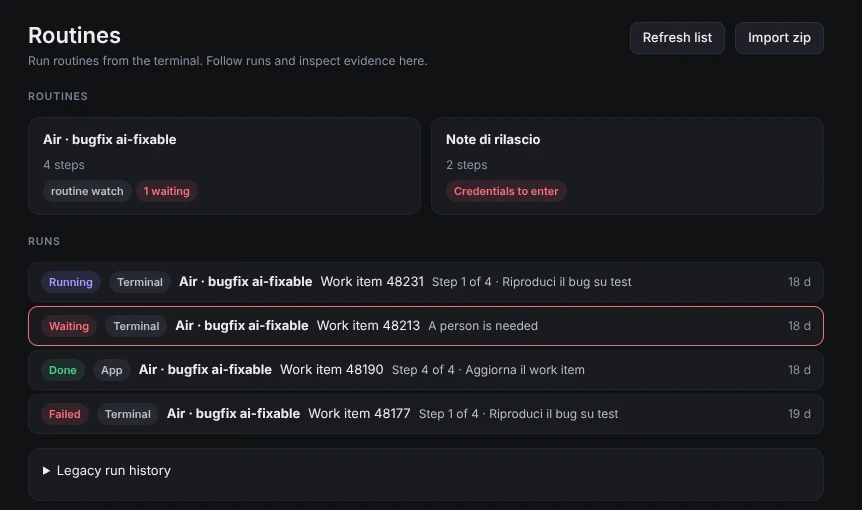</p>

### Lost? There's a guide

Every concept of the app as a card: how it works, an everyday analogy, the source files. **Discuss** sends the card to
the Orchestrator to explain it your way.

<p align="center">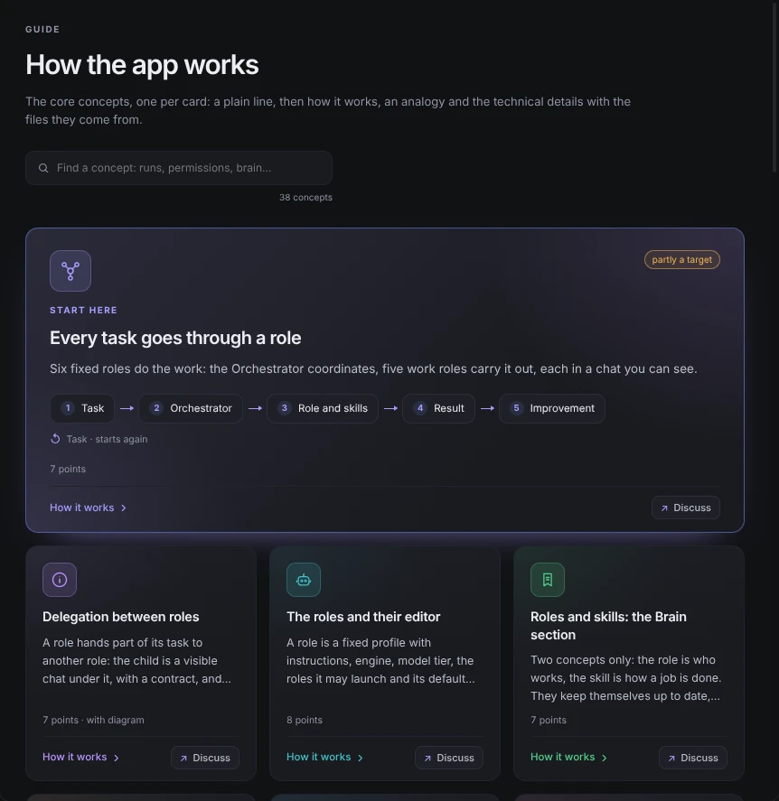</p>

## Also on board

- **Answer with one key.** Questions and permissions show up as cards in one window, with an estimate before and a
  verdict after.
- **Browsers they drive.** Real tabs inside the app over MCP: the agents click, type and take screenshots.
- **A browser of your own.** The Browser page is your everyday browser, with bookmarks, sessions and passwords the
  agents never see; lend them one tab when you want.
- **Connectors.** MCP servers in Settings, switched on per role.
- **A brain in plain Markdown.** Notes, rules, skills and scripts live in a folder you own, readable without the app.
- **Your own logins.** It drives the official CLIs with your account and never touches their settings. The UI speaks
  Italian, English and German.

<p align="center"></p>

## The rest

Everything else lives where agents (and the occasional human) can find it: [AGENTS.md](AGENTS.md) for the rules and
commands, [CONTRIBUTING.md](CONTRIBUTING.md) for the workflow, [docs/architecture.md](docs/architecture.md) and
[docs/adr/](docs/adr/) for the why, [CHANGELOG.md](CHANGELOG.md) for the what. Just the brain, without the app:
`node brain-template/install.mjs`.

Use it at your own risk: agents run commands on your machine with the permissions you give them, so read what they
propose before you approve it. Check the Anthropic, OpenAI and Cursor terms before you use it with a subscription.

## License

[MIT](LICENSE)
