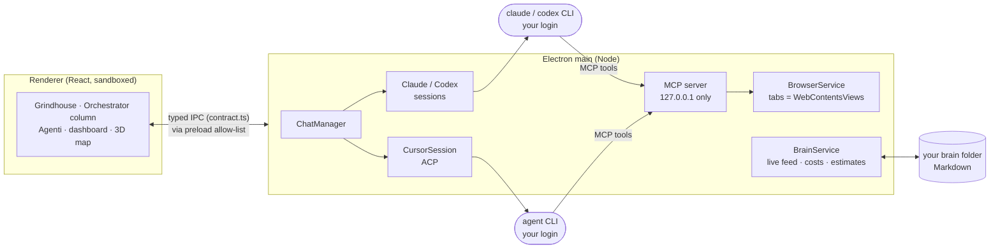

<p align="center">
  
</p>

<h1 align="center">second-brain</h1>

<p align="center">
  <b>One desktop cockpit for all your AI coding agents.</b><br>
  Run Claude Code, Codex and Cursor agents side by side, answer every question they ask from one place,<br>
  watch the browsers they drive, and keep a second brain that makes them better every week.
</p>

<p align="center">
  <a href="#download"><b>Download</b></a> ·
  <a href="#try-it-in-2-minutes"><b>Try the demo</b></a> ·
  <a href="#build-it-yourself"><b>Build from source</b></a> ·
  <a href="#update"><b>Update</b></a> ·
  <a href="CONTRIBUTING.md"><b>Contribute</b></a>
</p>

<p align="center">
  
  
  
  
  
</p>


When you work with five agents at once, the bottleneck is no longer the model: it is you. Which agent is waiting on
you? Which one is burning tokens in a loop? What did the QA agent see in its browser? second-brain puts every agent,
question, browser and ticket on one screen, so you spend your attention where it is needed and nowhere else.

It does not replace the agents: it starts the **official** CLIs (`claude`, `codex`, Cursor's `agent`) with **your own**
login, and it never touches their settings. Keep Claude desktop and Cursor open next to it, or close them.

> The interface speaks Italian and English (Settings → Lingua; by default it follows Windows). Code, comments, docs
> and commits are in English.

## Download

| Version | Date | Windows installer | Source code |
| --- | --- | --- | --- |
| **0.1.0** (latest) | 2026-10-13 | coming with the published release | [zip](https://github.com/lampi1/second-brain/archive/refs/tags/v0.1.0.zip) · [tar.gz](https://github.com/lampi1/second-brain/archive/refs/tags/v0.1.0.tar.gz) |

Every version, with its notes and checksums: **[all releases](https://github.com/lampi1/second-brain/releases)** ·
what changed: [CHANGELOG.md](CHANGELOG.md).

- **Windows installer**: one offline, per-user `second-brain-<version>-windows-x64-setup.exe`. No Node.js, Git or
  admin rights needed; it includes Electron and the app. Check the file against the `.sha256` next to it in the release.
  Not code-signed yet, so Windows SmartScreen may ask you to confirm the first time ("More info" → "Run anyway").
- **Source code**: the exact code of that version, to [build it yourself](#build-it-yourself).
- The repository is private today, so these links work for people with access to it; it is meant to be open source.

## Try it in 2 minutes

No CLI, no login, no tokens: the demo runs the whole interface on fictional data.

```powershell
git clone https://github.com/lampi1/second-brain.git
cd second-brain
npm run setup      # pinned dependencies (install scripts off) + the Electron binary + the git hooks
npm run demo       # builds and opens the app with demo agents, browser tabs and a sample brain
```

You need [Node.js](https://nodejs.org) 22+ and [Git](https://git-scm.com). Windows 10/11 is the tested platform;
Linux and macOS are built for but not yet tried on a real machine (ADR 0054).

## Build it yourself

From the clone above, three commands take you from the code to your own running copy:

```powershell
npm run setup      # once (and again only if package-lock.json changes: `npm run pull` does that for you)
npm run build      # main + preload with esbuild, the React interface with Vite → out/
npm start          # opens the app; on first start a short setup window creates or links your brain
```

To use real agents, install and log in to at least one CLI yourself:
[Claude Code](https://docs.anthropic.com/en/docs/claude-code) (`claude`), Codex (`codex`) and/or the Cursor CLI
(`agent`). The app never asks for your passwords. `npm run doctor` tells you what is still missing (Electron, build,
CLIs, logins, brain, MCP port).

### Change it

```powershell
npm run dev            # dev build + run: edit, run again, see it
npm run check:branch   # before you commit: typecheck, lint, the related unit tests, the secrets guard
```

Where things are:

| Folder | What lives there |
| --- | --- |
| `src/shared/contract.ts` | The one contract: every data shape and IPC channel. Change it first, then both sides. |
| `src/main/` | Electron main process: agent harnesses (`chats/`), browser tabs (`browser/`), local MCP server (`mcp/`), brain and costs (`brain/`). |
| `src/preload/` | The small allow-listed bridge `window.sb`. Nothing else crosses. |
| `src/renderer/` | The React interface (pages, components, Italian and English strings in `i18n/`). |
| `test/unit`, `test/e2e` | Vitest for every module, Playwright driving the real app for every visible feature. |
| `docs/adr/` | Every decision, numbered, with its reason. |

Or let the app change itself: ask the Orchestrator for the change and give it the app's code folder; it starts an agent
there that works on a branch and runs the checks before anything is merged.

Start with [CONTRIBUTING.md](CONTRIBUTING.md) (workflow, tests, ADRs, a map of the modules). AI agents working on the
repo read [AGENTS.md](AGENTS.md).

## Update

**From a clone (developers): one click.** Open **Impostazioni → Aggiornamenti**: it shows what is new on GitHub's
`main`, and **Aggiorna** downloads it, rebuilds and restarts the app on it, with no test suite. It only fast-forwards:
your local commits and uncommitted work are never merged, moved or dropped (it stops and tells you), and the
dependencies are reinstalled only when they changed. You can also write "aggiornati" to the Orchestrator, or from a
terminal:

```powershell
npm run pull       # fetch main, fast-forward, `npm ci` only when the lockfile changed, build
```

**Installed with the Windows installer:** download the newer installer from [Releases](https://github.com/lampi1/second-brain/releases).
Your brain, chats and settings live outside the install folder and are never removed by the installer. An in-app
updater that prepares the package in the background and asks you once is built, and is switched on after its Windows
restart test passes ([update integration](docs/update-integration-evidence.md)).

**Your stable copy from a clone** (ADR 0007): the same **Aggiorna** switches it to the new version at once; if the new
version does not open, the launcher goes back to the previous one. `npm run promote` does it with the full checks
first, `npm run rollback` goes back by hand.

## Features

### Agents as strips, questions as panels

Every Claude Code, Codex or Cursor agent is a strip in the **Grindhouse** with its streaming text, tool calls, diffs,
cost and context size. When an agent asks a question or a permission, it shows up as a panel right in its strip (or in
a floating layer, wherever you are in the app): answer with one key, with the context the agent had when it asked.
Strips are grouped by area and ordered by the Orchestrator; a click anywhere on one expands it inline, and it
maximizes or opens in focus mode. The globe on a strip shows the browser its agent drives beside it (expanding the
strip if needed). Work starts only from the Orchestrator's column (Ctrl+N: "Cosa vuoi fare?"); the chats a role
delegates hang under it as thread cards on a curved line (task, character, skills, model, live steps from the
engine's own plan and its tool calls, state, what it needs), expand in place into the whole chat, and fold per parent
(kept across restarts), the same tree as in the sidebar. A child's question goes to its parent first; what needs you
shows once, in the chat you look at. Model and effort come from the agent's profile. A worker that sent
its final report to the Orchestrator and went idle closes by itself after a short delay (Settings → Archivia lavori
conclusi dopo; transcript kept, Ctrl+K reopens it); one that waits for you, a permission, colleagues or background
work stays open with an "In attesa di…" label.

**Quick chats and readable estimates** (ADR 0087): before it starts work the Orchestrator estimates the request from
similar past tasks (same agent and same kind first; time, cost, how many tasks it rests on, its confidence, the parts
of the request). A short question it answers itself; a quick single-part job goes to one agent with no sub-chats;
only work in several parts becomes a delegation tree, which costs more tokens. Every strip reads "stima ~4 min ·
~0,12 $ · su 12 task simili" and, once done, "~4 min → 6 min ✓"; its "?" explains how the figure is computed. The
Orchestrator's plan lists the agents it started today with their estimates, a "via rapida" mark on quick jobs, the
sum, and how accurate the estimates have been week by week (each finished task re-estimated from the ones before it).

### Cloud agents next to the local ones

Agents that run in the vendor's cloud (Cursor Cloud Agents, Codex cloud tasks, Claude Code cloud sessions) keep going
with the PC asleep and cost no local CPU. Ask the Orchestrator for one (it starts it with `app_create_chat`, where "cloud")
on a GitHub repository whose branch is already pushed: it gets its own strip in the Grindhouse, grouped by repository,
with a "cloud" badge. Cursor streams its messages, takes follow-ups and stops from the app (its cloud runs at API
prices, counted in the Cursor spending limit; the key goes in Settings → Motori → Cursor); Codex and Claude open their
own page for what their CLIs do not offer. "Porta in locale" brings the result into a new worktree. The agent pushes
only its own `cursor/…`, `codex/…` or `claude/…` branch; the app never pushes (ADR 0080).

### The Orchestrator: one chat that coordinates the others


The Orchestrator is the chat you talk to first, always in its column on the right. It knows every agent, picks the
right one from your catalog for each job (or proposes a new one, created only after your yes), routes mail between them
and tells you what needs you. Model, effort and context size come from each agent's profile, never from a per-chat
switch. News it has not received yet (a chat that finished while it waits for your answer, a quiet permission request,
mail held for later) shows above its input as **"N novità in attesa"**; a click lists each one with its chat, kind,
since when and why it waits, at no token cost.

### Agents that improve by themselves, reversibly


Each agent is a card with its role, engine, model and observed results (runs, success, cost); a click flips it to its
details and the skills it uses. Every role has its own cartoon character (a conductor for the Orchestrator, an explorer
for the Scout, a judge in a wig…), recognisable from the 16 px tree to the 96 px role page. Agents learn from cost, time, outcome and your corrections: the Orchestrator and the
maintenance jobs change an agent's model, effort or instructions by themselves, as a trial version measured against
the previous one, and every change is in the log with "Annulla". Only what reaches further waits for your yes in
**Agenti → Da approvare**: an agent's tools, permissions and engine, and new agents. An agent exports to a colleague
with its profile, its skills, the tools they call and the brain's rules, never your memory.

### Browsers your agents drive


Agents get real browser tabs inside the app through a local MCP server: navigate, click, type, read the page, take
screenshots, with trusted input like a real user. Each tab sits next to the agent that owns it. Logins persist per
environment, and when a page needs a password, MFA or a CAPTCHA the agent hands it to you: the app never types your
passwords.

### A live map of your brain


Your brain is a folder of Markdown notes the agents read and write: open threads, journal, ideas, the errors they made
and the rules learned from them. A fresh brain starts empty: the app's own rules and tools stay inside the app
(ADR 0072). The Brain section of the menu shows it as two concepts only, agents and skills (ADR 0077): Agenti, Skill
(who uses each skill, linked with one click), Regole (the brain's rules and, once the brain has some, the rules it
learned for its estimates, model choice and alerts), Memoria (knowledge, what happened, one memory per agent),
Classificatori (one card per classifier: what it decides and why, its runs, verified success, cost and weekly trend,
how far it has learned, a curious fact from the data, and a detail view with its history; the task estimator's card
shows week by week how often its estimate held) and Mappa (agent → skills → rules → memory, the
notes map that fills the panel at any size, and a 3D map that lights up the files, tools and agents at work).
Maintenance jobs keep skills, agents, rules and memory tidy by themselves; every change is logged with "Annulla".

### Scripts and a changelog for your brain


The scripts your agents wrote and tested live in the brain's `scripts/` folder, each with what it does, how to run it
and its last test. Every chat can look them up before writing a new one; the Orchestrator adds, fixes and deletes them
on its own, and every change to the brain (scripts, rules, skills, notes) lands in `changelog.md`. Both have their own
page in the Brain section (ADR 0076). Nothing in the app runs a script.

### Task in one page


Mentions, comments and votes on your pull requests, reviews waiting for you, stuck work items, failed builds and the QA
status of each pull request, imported from Azure DevOps on demand or automatically (zero tokens, read only). Every item
has **Discuti**: one click puts a ready message about it (title, link, state, folder) in the Orchestrator's input, and the
Orchestrator decides and opens the work chat. Every page works the same way: no page opens a work chat by itself. **Fatto** is the log of what was done: newest first, grouped by day, each entry with
what, who (you, or the agent or engine of a chat), when and its link.

### Quality you can measure


Four metrics computed from real logs, each with its source and the days it covers: errors you had to catch yourself
per 100 turns, rules that did not stop their error, pull requests held by QA or builds, bugs reopened after a fix.
Costs, budgets and estimates per agent and per day sit next to them, with charts per day and per model and a few
facts drawn from the numbers. The Errori tab groups recurring errors by cause, with how often, the trend, when last
seen, which chats, roles and skills, what it means and what to do. Every number has a "?" that says how it is computed.

### And more

- **Esegui**: shell blocks in a chat run with one click, and the output goes back to the chat.
- **Long chats** are handed off before the context fills: a note, then "Riprendi" in a fresh chat.
- **Nine fixed roles** (ADR 0083): Orchestrator, Strategist, Scout, Artisan, Sentinel, Herald, Router, Judge, Scribe,
  each with its tools, permission ceiling, model tier and skills, editable in Brain → Agenti. A role delegates parts of
  its task to the roles it may launch (`agent_delegate`) as visible child chats with a self-contained contract; a
  child never gets more permissions than its parent, works in its folder, and reports once (`agent_report`). The
  planners (Strategist, Router) launch only Scout and Judge: what must change goes in their report and the
  Orchestrator starts it, so every change starts from the Orchestrator. The
  depth and the children at once are your limits (Impostazioni → Ruoli e deleghe). The Orchestrator sees only their
  state, plus what you write to any of them, so nothing conflicts; a Judge reviews a few finished runs a day on
  another model.
- **Search** (Ctrl+K) across chats, browser tabs, pages and commands; an in-app **Guida** explains every concept.
- **Agent-friendly by design**: an app-control MCP server lets agents read the app state, screenshot it and drive it.
- **Screenshots everywhere**: an agent writes the path of a PNG, JPG or WebP (under the brain, the repo, a worktree or
  its evidence folder) and the app shows it as a thumbnail in the chat and in the question; Markdown and HTML reports
  open in the file viewer with their images (files beside the report or base64), never loaded from the internet. A
  click opens any of them large.

## Architecture



Details: [docs/architecture.md](docs/architecture.md); every decision: [docs/adr/](docs/adr/).

## Security model

- Electron baseline, never relaxed: `contextIsolation`, `sandbox`, no `nodeIntegration`, a strict CSP, every IPC call
  checked against its sender, preload exposes only an allow-listed `window.sb`.
- The MCP server listens on 127.0.0.1 only, with Host/Origin checks. Per-chat browser endpoints scope browser tools to
  that chat's tabs; tokenized Orchestrator endpoints identify their caller. Generic local endpoints are also reachable
  by local processes: this is not a boundary between programs on the same computer.
- Browser tabs live in their own partition, apart from the app.
- Each CLI owns its login. API keys you type in Settings are encrypted with the OS secret store and decrypted only in
  main. App-owned conversation history is stored as plain text in your local profile: treat profile backups as private.
- No production access is wired in: no database, deploy or write-cloud commands.
- Dependencies: exact versions, well-known packages, published at least 14 days before they are installed; npm install
  scripts are off (`.npmrc`). A git hook scans every commit for secrets and personal data before it leaves your PC.

## Releasing (maintainers)

GitHub Actions are off for this repository, so a release is built on a Windows PC:

```powershell
npm run check                      # on a clean main: everything, e2e included
git tag v0.2.0                     # the version in package.json; push the tag
npm run package:windows            # Setup + update payload + checksums in test-results/installer/dist
npm run test:installer             # installs those exact bytes in a temp profile and launches them
npm run release:draft -- v0.2.0    # verifies tag, source and hashes, then creates a DRAFT release with gh
```

Review the draft on GitHub, publish it, and add its row to the [Download](#download) table. Details:
[Windows installer and updates](docs/windows-installer.md).

## Roadmap

- Linux and macOS proved on real machines; installers (.dmg, .AppImage) with signing.
- More connectors behind the same interface (issue trackers beyond Azure DevOps).
- Team features: handing a to-do to a colleague, a shared team layer next to each person's brain.

## Limits

- **Use at your own risk.** A personal project, provided as is, without warranty (see [LICENSE](LICENSE)). Agents run
  commands on your machine with the permissions you give them: read what they propose before you approve it.
- **Logins and terms of service.** The app only drives the CLIs you installed and logged into yourself, for your own
  use. Anthropic's terms do not allow third-party products to offer Claude.ai (subscription) login to their users:
  check the current Anthropic, OpenAI and Cursor terms before you use it with a subscription, give it to others or
  build on it.
- **Each engine spends only its own tokens**: a Claude chat never starts Cursor and vice versa.

## License

[MIT](LICENSE)
