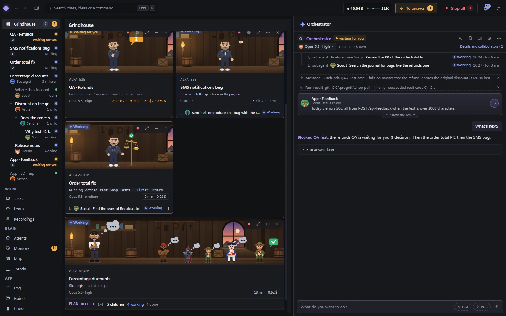
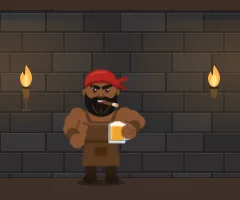
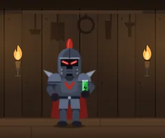
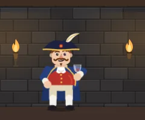
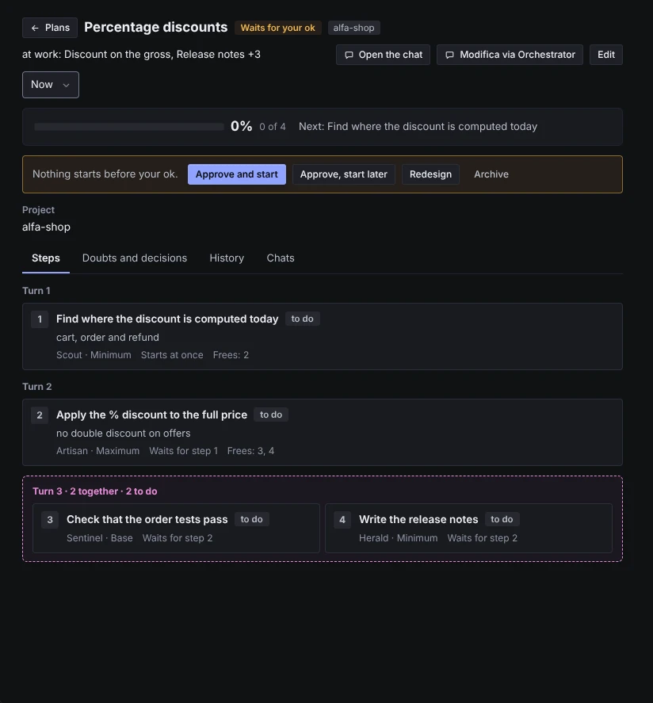

<!-- Product overview for humans: what the app is, why it matters, how to start it. Operating rules for agents live in AGENTS.md. -->
<p align="center"></p>
<h1 align="center">second-brain</h1>

<p align="center">
  <b>One chat commands every coding agent you have. A brain remembers what they learn.</b><br>
  Claude Code, Codex, Cursor, OpenCode and ACP agents on one screen, with your own logins.
</p>

<p align="center">
  <a href="LICENSE"></a>
  
  
  <a href="CONTRIBUTING.md"></a>
</p>



> **Full disclosure:** the developer of this app has never written a single line of its code, and has not *read* one
> either. AI agents wrote all of it, the agents reviewed it, and the agents wrote this sentence too. The developer
> mostly types wishes in Italian and drinks coffee. It works surprisingly well, which is either the point of the app or
> a warning.

## The idea

You talk to **one** chat: the **Orchestrator**. It plans, splits the job and sends each piece to a crew of five, every
one on the engine and model you chose for it. You watch them work side by side, and you only step in for what really
needs you.

```text
                  you
                   │
            ┌──────▼───────┐
            │ Orchestrator │   plans, delegates, answers the crew, tells you what waits
            └──────┬───────┘
   Strategist · Scout · Artisan · Sentinel · Herald        the crew, each on its own engine
                   │
   Claude Code · Codex · Cursor · OpenCode · ACP agents    your CLIs, your logins
                   │
            ┌──────▼───────┐
            │    brain     │   skills · journal · artifacts: a Markdown folder you own
            └──────────────┘
```

## Meet the crew

<p align="center"></p>

Each one has a vice for the quiet moments:

<p align="center">
  
  
  
  
  
  
</p>

| Role | Does |
|------|------|
| **Orchestrator** | Your single entry. Routes the work, answers the crew's questions, asks you only what is yours. |
| **Strategist** | Turns a big job into a plan on the project map, waits for your OK, launches the steps and their reviews. |
| **Scout** | Finds things: code, logs, docs. Reads, never writes. |
| **Artisan** | Makes the change and proves it works. |
| **Sentinel** | Reviews the diff with fresh eyes. Trusts nothing. |
| **Herald** | Drafts messages for people and outside services. Nothing is sent without your OK. |

## What you get

- **Every engine, per role.** Claude Code on one role, Codex on another, Cursor on a third. Each role card holds its
  model presets (Minimo, Base, Massimo) and its code mode.
- **Plans you can see.** The Strategist draws the plan on the project's map; boxes turn green as the crew finishes.
- **No collisions.** Every writing agent gets its own git worktree.
- **No leftovers.** A number beside Grindhouse counts the agents at work; when one ends, what it started ends with it,
  except the shared environments held by a lease.
- **Your rules.** A `permissions.json` in your brain decides what waits for your click. Production, databases and the
  cloud always wait for your own yes.
- **A real browser.** QA agents drive your test environment in a tab next to their chat and bring back screenshots.
- **A brain that learns.** Skills, journal and artifacts in plain Markdown. **Maintenance** reads the past work and
  proposes only the skill changes that matter, each with a reason and an Undo.
- **Voice and phone.** Dictation, voice conversation, call transcripts, Telegram. All speech runs on your PC.
- **Also on board.** The **Tasks** page for your work items, **Trends** and the **Log**, **Memory** with the brain
  **Map**, **Scripts**, **Recordings**, lessons in **Learn**, a searchable **Settings** page, and **Chess** against
  your agents.

<p align="center"></p>

## Quick start

No installer yet: it runs from source. You need git and Node.js 22 or newer.

```sh
git clone https://github.com/lampi1/second-brain.git
cd second-brain
npm run setup    # pinned dependencies, the Electron binary, the git hooks
npm run demo     # the whole app on fictional data: no login, no tokens
```

For the real thing, log in to at least one of `claude`, `codex` or Cursor's `agent`, then:

```sh
npm run build && npm start
npm run doctor   # says in plain words what is still missing
```

Lost? Ask the Orchestrator. It knows the app inside out and changes any setting for you, with an Undo.

## More

[AGENTS.md](AGENTS.md) (for AI agents) · [CONTRIBUTING.md](CONTRIBUTING.md) · [Vision](docs/VISION.md) ·
[Architecture](docs/architecture.md) · [Decisions](docs/adr/README.md) · [Changelog](CHANGELOG.md) ·
[Security](SECURITY.md)

Agents run commands on your machine with the permissions you give them: read what they propose before you approve it,
and check your vendors' terms before using a subscription.

[MIT](LICENSE). Third-party notices in [NOTICE](NOTICE): the chess engine, Stockfish, is a separate GPLv3 program
shipped unmodified in `vendor/stockfish/`.
