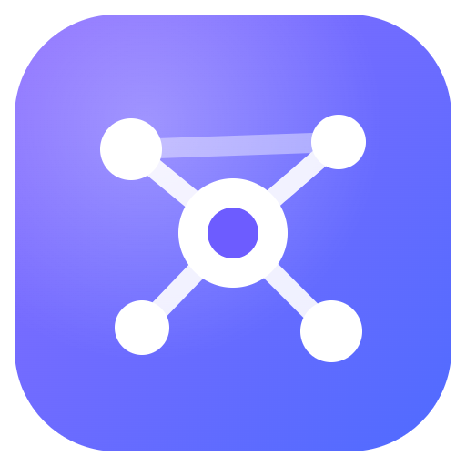
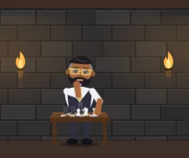
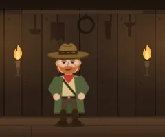

<!-- Product overview for humans: what the app is, why it matters, how to start it. Operating rules for agents live in AGENTS.md. -->
<p align="center"></p>
<h1 align="center">second-brain</h1>

<p align="center">
  <b>One chat commands every coding agent you have. A brain remembers what they learn.</b><br>
  Claude Code, Codex, Cursor, OpenCode and ACP agents on one screen, with your own logins.
</p>

<p align="center">
  <a href="LICENSE"></a>
  
  
  <a href="CONTRIBUTING.md"></a>
</p>


> **Full disclosure:** the developer of this app has never written a single line of its code, and has not *read* one
> either. AI agents wrote all of it, the agents reviewed it, and the agents wrote this sentence too. The developer
> mostly types wishes in Italian and drinks coffee. It works surprisingly well, which is either the point of the app or
> a warning.

## The idea

You talk to **one** chat: the **Orchestrator**. It plans, splits the job and sends each piece to a crew of four specialists, every
one on the engine and model you chose for it. You watch them work side by side in the **Grindhouse**, and you only step in for what really
needs you.

```text
                  you
                   │
            ┌──────▼───────┐
            │ Orchestrator │   plans, delegates, answers the crew, tells you what waits
            └──────┬───────┘
       Strategist · Scout · Artisan · Sentinel             the crew, each on its own engine
                   │
   Claude Code · Codex · Cursor · OpenCode · ACP agents    your CLIs, your logins
                   │
            ┌──────▼───────┐
            │    brain     │   skills · journal · artifacts: a Markdown folder you own
            └──────────────┘
```

## Meet the crew

<p align="center"></p>

Each character has a vice for the quiet moments (all six also play in **Chess**):

<p align="center">
  
  
  
  
  
  
</p>

| Role | Does |
|------|------|
| **Orchestrator** | Your single entry. Routes work, manages plans, answers the crew's questions, asks you only what is yours. |
| **Strategist** | Turns a big job into a plan on a map of its own, waits for your OK, launches the steps and their reviews. |
| **Scout** | Finds things: code, logs, docs, browser state. Reads, never writes. |
| **Artisan** | Builds the change, writes docs or brain notes, drafts external messages (sent only with your OK), and proves it works. |
| **Sentinel** | Reviews the diff and runs checks with fresh eyes. Trusts nothing. |

## What you get

- **Orchestrator-first cockpit.** A chat-focused sidebar with role mini-icons keeps up to 20 parallel chats in sight, while secondary views live in a quiet hamburger menu (**Work**, **Leisure**, **System**). In the Orchestrator column: `Ctrl+F` search, `[Topic]` thread filters, hover quote/reply, and an instant red **Stop** button right in the composer.
- **Every engine, per role.** Claude Code on one role, Codex on another, Cursor or Antigravity/ACP on a third. Manage **Agents** with per-role model presets (`Minimo`, `Base`, `Massimo`), **Model tiers**, code mode, and zero-token RPG levels (`Lv N` + Pat/Whack).
- **Plans you can see.** Every job has its own clean map managed through the Orchestrator: you approve, start, adjust or stop it there, with tolerant remaining-time estimates (parallel and sequential) and boxes that turn green as the crew finishes.
- **Only the questions nobody else can answer.** A worker's question goes to its Strategist, then to the Orchestrator, then to you; one open doubt and the plan cannot be approved. Commands state what they do in one clear line with explicit **Run**, **Already done**, and **Skip** choices.
- **No collisions, no freezes, no leftovers.** Every writing agent gets its own git worktree, lifecycle scans run in `O(N)` with indexed SQLite assignments and 60fps CSS-composited sprites, and when a chat ends, what it started ends with it (except leased shared environments).
- **Your rules.** A `permissions.json` in your brain decides what waits for your click. Production, databases and the cloud always wait for your own yes.
- **A real browser.** QA agents drive your test environment in a tab next to their chat and bring back screenshots.
- **A brain that learns.** **Memory**, **Skills**, **Scripts**, journal and artifacts in plain Markdown. **Maintenance** reads past work and proposes only the skill changes that matter, each with a reason and an Undo.
- **Voice, phone and Remote Mode.** Local dictation, voice conversation, call **Recordings**, and **Remote Mode** on both Claude (`claude.ai/code`) and Antigravity/ACP engines through the **Telegram** phone bridge.
- **Also on board.** **Tasks**, **Trends**, **Log**, the 2D brain **Map**, searchable **Settings**, and **Leisure** with a curated multi-edition **News** reader and **Chess** against your animated crew.

<p align="center"></p>

## Quick start

No installer yet: it runs from source. You need git and Node.js 22 or newer.

```sh
git clone https://github.com/lampi1/second-brain.git
cd second-brain
npm run setup    # pinned dependencies, the Electron binary, the git hooks
npm run demo     # the whole app on fictional data: no login, no tokens
```

For the real thing, log in to at least one of `claude`, `codex` or Cursor's `agent`, then:

```sh
npm run build && npm start
npm run doctor   # says in plain words what is still missing
```

Lost? Ask the Orchestrator. It knows the app inside out and changes any setting for you, with an Undo.

## More

[AGENTS.md](AGENTS.md) (for AI agents) · [CONTRIBUTING.md](CONTRIBUTING.md) · [Vision](docs/VISION.md) ·
[Architecture](docs/architecture.md) · [Decisions](docs/adr/README.md) · [Changelog](CHANGELOG.md) ·
[Security](SECURITY.md)

Agents run commands on your machine with the permissions you give them: read what they propose before you approve it,
and check your vendors' terms before using a subscription.

[MIT](LICENSE). Third-party notices in [NOTICE](NOTICE): the chess engine, Stockfish, is a separate GPLv3 program
shipped unmodified in `vendor/stockfish/`.
