<!-- Product overview and source setup for users and contributors. Detailed operating rules live in AGENTS.md. -->
<p align="center">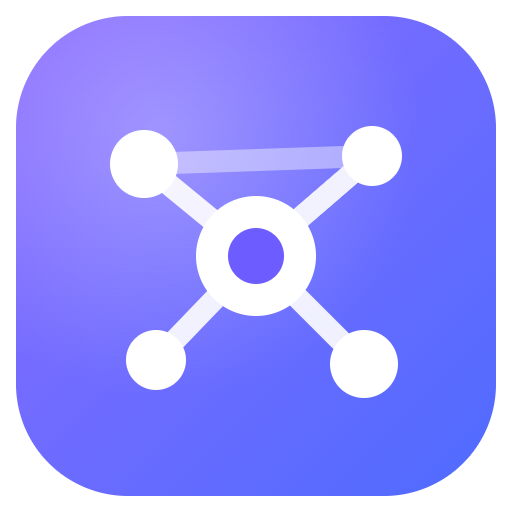</p>
<h1 align="center">second-brain</h1>

<p align="center">
  <b>One Orchestrator for all your coding agents, and a brain that remembers what they learn.</b><br>
  Claude Code, Codex, Cursor, OpenCode and other ACP agents on one screen, with your own logins.
</p>

<p align="center">
  <a href="LICENSE"></a>
  
  
  <a href="CONTRIBUTING.md"></a>
</p>

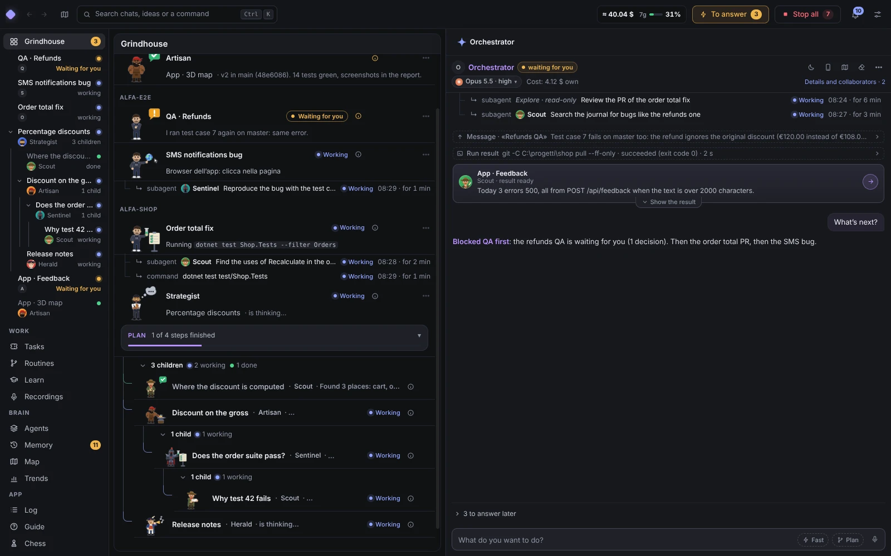

## What it is

second-brain is a desktop app that does two things.

**It orchestrates agents across harnesses.** You talk to one chat, the Orchestrator. It splits the work and hands it
to five roles (Strategist, Scout, Artisan, Sentinel, Herald), each running on the engine and model you pick: one
role on Claude Code, another on Codex, a third on Cursor. Every delegated job is a visible chat in a tree, with its
steps, its cost and its result. Questions and permissions come back to one place, and the Orchestrator can answer
most of them for you.

**It keeps a brain.** Skills and memory live in a folder of plain Markdown that you own and can read without the app.
Agents start a job with the skills and the facts that fit it, and what they learn comes back as proposals. A
Maintenance pass merges duplicates, files the lessons from your corrections and proposes skill changes, each with a
reason and an Undo.

The app drives the official CLIs with your accounts and never touches their settings.

```text
                  you   (desktop · Telegram · claude.ai Remote Control)
                   │
            ┌──────▼───────┐
            │ Orchestrator │   plans, delegates, answers the agents, tells you what waits
            └──────┬───────┘
   Strategist · Scout · Artisan · Sentinel · Herald        roles, each on its own engine and model
                   │
   Claude Code · Codex · Cursor · OpenCode · ACP agents    your CLIs, your logins
                   │
            ┌──────▼───────┐
            │    brain     │   skills · memory · journal: a Markdown folder you own
            └──────────────┘
```

> **Full disclosure:** the developer of this app has never written a single line of its code, and has not *read* one
> either. AI agents wrote all of it, the agents reviewed it, and the agents wrote this sentence too. The developer
> mostly types wishes in Italian and drinks coffee. It works surprisingly well, which is either the point of the app or
> a warning.

## Contents

- [Quick start](#quick-start)
- [Orchestration](#orchestration)
- [The brain](#the-brain)
- [See what happens](#see-what-happens)
- [Learn](#learn)
- [Voice, calls and the phone](#voice-calls-and-the-phone)
- [Also on board](#also-on-board)
- [Documentation](#documentation) · [Contributing](#contributing) · [License](#license)

## Quick start

There is no installer yet: the app runs from source. You need git and Node.js 22 or newer.

```sh
git clone https://github.com/lampi1/second-brain.git
cd second-brain
npm run setup    # pinned dependencies with install scripts off, the Electron binary, the git hooks
npm run demo     # the whole app on fictional data: no CLI, no login, no tokens
```

When you want the real thing, log in to at least one of `claude`, `codex` or Cursor's `agent` yourself, then:

```sh
npm run build && npm start
npm run doctor   # says in plain words what is still missing on this machine
```

Updating later is one click, **Settings → Updates → Update** (it pulls `main`, rebuilds and restarts), or
`npm run pull` in a terminal.

### Or let your agent do it

Open Claude Code, Codex, Cursor or whatever agent you trust with a terminal, and paste this:

```text
Set up the second-brain desktop app for me, from source, so I can use it and also hack on it.

1. Check my machine first: git, Node.js (the version in package.json "engines", 22 or newer), npm, and the GitHub
   CLI `gh`. If something is missing, tell me what and how you would install it the normal way for my OS
   (Windows: winget; macOS: Homebrew; Linux: my package manager or nvm), and install it only after I say yes.
2. Get the code. If `gh auth status` says I'm not logged in, run `gh auth login` and let me finish it myself.
   If I can't push to lampi1/second-brain (most people can't), ask me before forking it, then clone my fork:
   `gh repo fork lampi1/second-brain --clone`; otherwise `git clone https://github.com/lampi1/second-brain.git`.
   Make sure `upstream` points to lampi1/second-brain.
3. Read AGENTS.md and CONTRIBUTING.md in the clone, and follow them from here on.
4. Install: `npm run setup` (pinned deps with install scripts off, the Electron binary, the git hooks).
   On Linux, if Electron fails to start, tell me which system libraries it asks for (e.g. libnss3, libgtk-3,
   libasound2), install them after I say yes, and try again.
5. Build and start: `npm run build`, then `npm start`. The first start opens a short setup window: I'll go
   through it myself. Then run `npm run doctor` and tell me in plain words what is still missing
   (for example: logging in to at least one of `claude`, `codex` or Cursor's `agent`, which I do myself).
6. Leave the clone ready for issues and pull requests: `gh repo view` works, `main` tracks upstream, and tell me
   the loop: a branch per change, `npm run check:quick` and a review before the merge, Conventional Commits in English,
   never `--no-verify`, the PR template in .github/. Don't push or open anything without asking me.

Finish with a three-line summary: where the code lives, how I start the app, and how I update it.
```

## Orchestration

<p align="center"></p>

### The Orchestrator and Flash

The **Orchestrator** is where work starts: it plans, hands each job to the right role, answers their mail and tells you
what is waiting. Worker questions, permissions, Strategist interviews and plan approvals show up in its column. Every
chat keeps its own reply field, so you can still write to any agent directly. Ask for a recap in your own words and
you get a short list per agent.

**Flash**, the tab next to it, is the "btw": a quick read-only agent on its own model that sees the Orchestrator's
conversation and answers side questions in seconds, without touching it. When the talk turns into real work, "Make it
a job" has Flash write a proper brief (goal, context, what to do, constraints, done when) and drops it in the
Orchestrator's input, unsent.

<p align="center">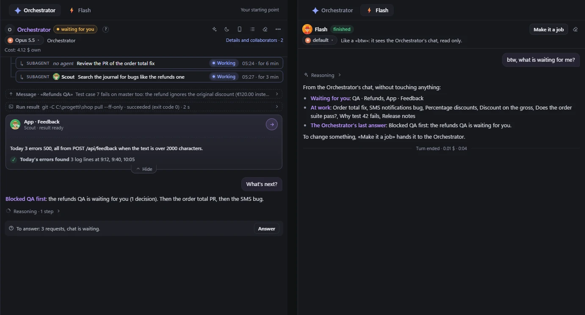</p>

The Orchestrator also knows the app inside out. "Where is the spending limit?", "turn notifications off", "give the
Scout the GitHub connector", "add this MCP server": it reads the app's live map and changes the setting for you, with
an Undo. Secrets stay yours, and a server it adds stays off until you read its command and click **Activate**.

### Any engine, per role

Engine, model and effort come from one picker, the same on the back of an agent's card, on the Orchestrator's model
chip and in a strip's menu: search the engines, see each model's context and effort, then say what changes, just this
chat or the default for new chats. The app runs the Claude Code installed on your PC, so a model out today shows up
the day your CLI knows it. Settings → Accounts and tools also proposes known ACP CLIs (Grok Build, Devin, Droid, Kilo
Code, Cline and more), all off: install one and sign in yourself, then "Turn on" makes it an engine like the others.

### Plan mode

Tick **Plan** to have a Strategist turn the job into steps. It interviews you first, one yes/no panel at a time (you
can always type your own answer, and **Basta domande** ends the interview early), then proposes a plan you approve
before anything is delegated. The roles' default skills and their prompt costs are listed in
[Skill alignment](docs/design/skills-alignment.md).

<p align="center">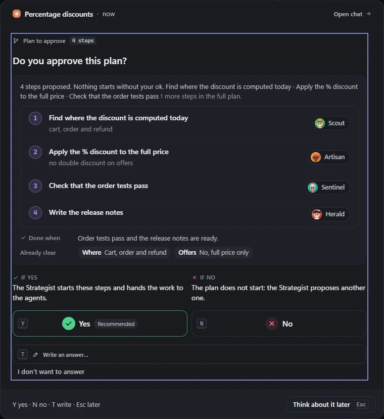</p>

### Parallel work without collisions

A delegated chat that writes gets its own git worktree, on a fresh branch at the parent's current HEAD. The app keeps
a small pool of them per repository and reuses a free, clean one, build outputs included. A worktree with uncommitted
changes or unpushed commits is never deleted: Settings → Advanced lists it, next to the limits and the disk space each
repository takes.

<p align="center">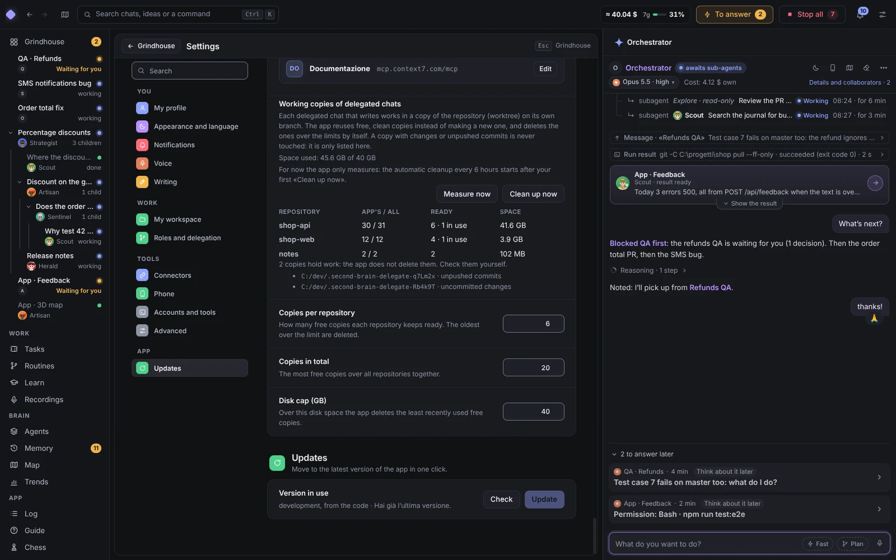</p>

### Your rules, not the app's

Agents may do everything by default. What stops them is a `permissions.json` file in your brain: a rule holds a
command for your click, asks you (from the phone too), or forbids printing a secret. After a refusal the agent goes on
with the rest. No file, no blocks (ADR 0254). The Orchestrator answers the agents for you, except for what touches
production, a database or Azure: that waits for your own yes.

### Agents that drive a real browser

Ask for a QA run and the agent opens your test environment in a browser tab inside the app, next to its chat: it
navigates, clicks, fills forms and takes screenshots on its own, and every step shows on its strip. The evidence
(screenshots, the failing value) lands in the report.

<p align="center">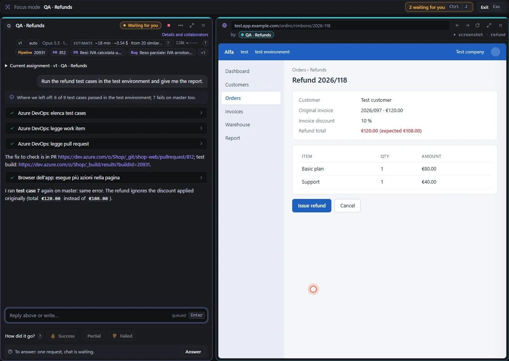</p>

## The brain

### Memory you swipe

Everything the agents learn lands as a card: a fact, a skill, a rule, a setting. Swipe right to keep it, left to drop
it (or the arrow keys, with Z to undo), and every card says who proposed it, in which chat and when. Behind the deck,
**Memory** is one hub with tabs (Proposals, Approved, Skills, the Rules always loaded, Ideas, Files). **Skills** follow the Agent Skills
format: each one is a package with its own Scripts, saved queries, references and assets.

<p align="center">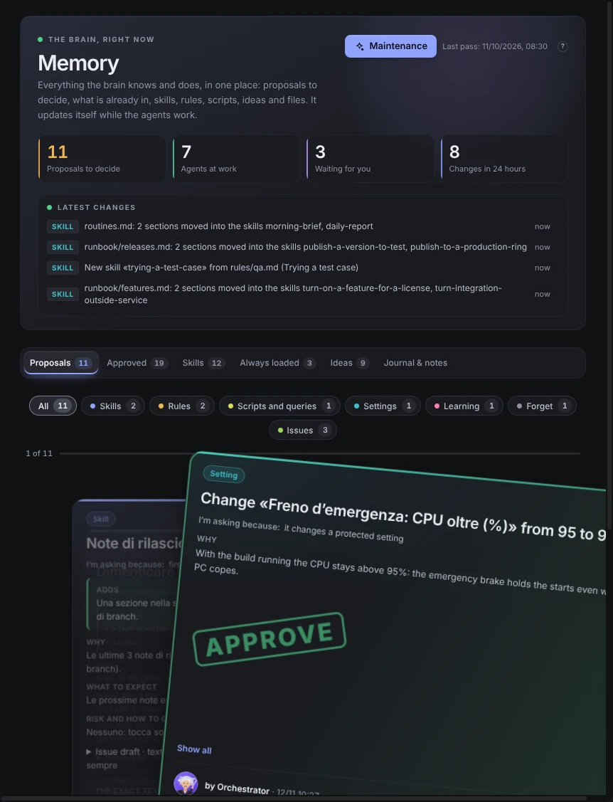</p>

### Maintenance

Press **Maintenance** and walk away. The free part merges duplicate skills, files lessons from your corrections and
moves scripts and ideas where they belong. Then an invisible agent (the strongest model, capped at $20) reads every
chat and work thread since the last Maintenance and proposes skill changes or new skills only where they are really
needed, plus improvements and app bugs. Roles never ask you about a skill change after each job, and every change has
a reason and an Undo.

### Agents that level up

Every role in **Agents** earns its level from verified outcomes only: a delegated job counts when its parent's work
checks out, and the Sentinel, the one who judges, is judged by what happens next. Reviews are cheap: free signals
first, then a sample of finished runs reviewed together in one quiet session on the first idle moment of the night.

<p align="center">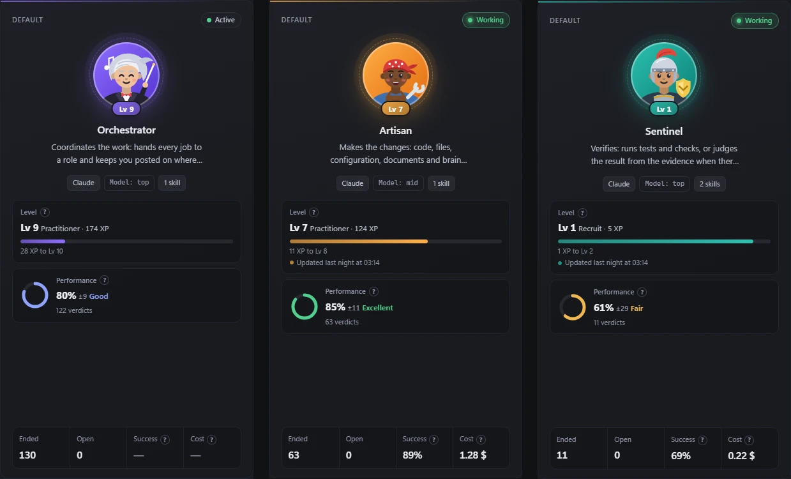</p>

### Quality you can measure

**Quality**, a tab of **Trends**, counts the AI's mistakes instead of its compliments: errors you had to catch
yourself per 100 turns, rules that actually stopped their error (or didn't, within 14 days), PRs held by a failed
build or QA, bugs that came back. Every number says where it comes from and how many cases it covers.

<p align="center">
  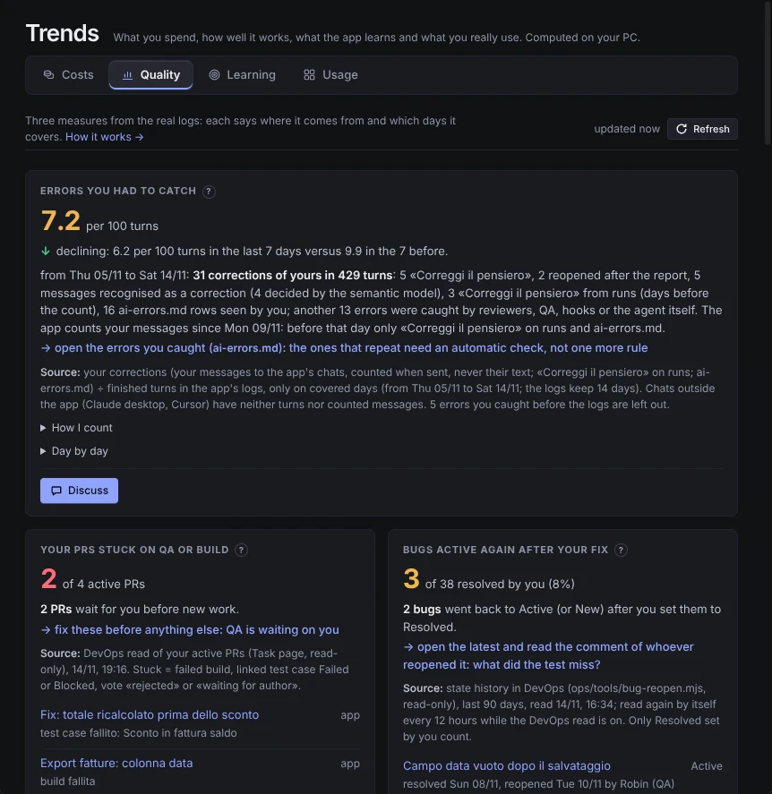
  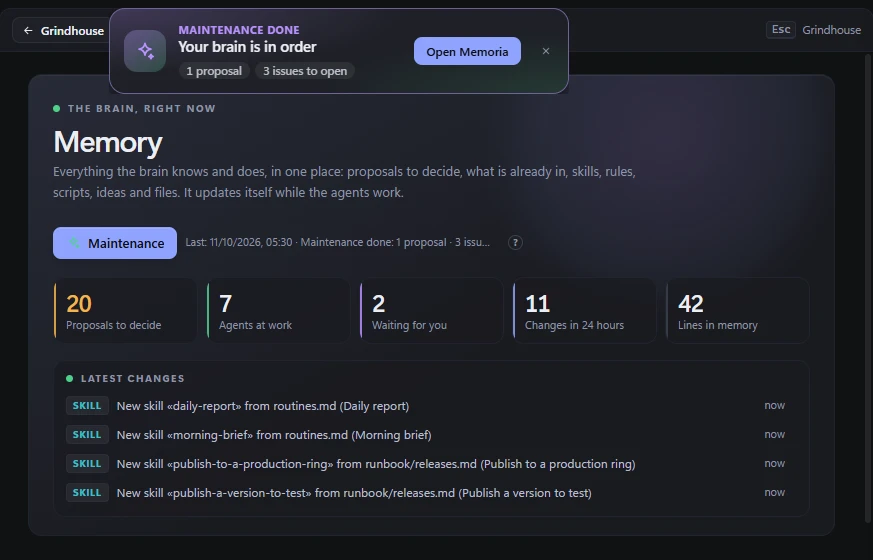
</p>

## See what happens

### Your projects, drawn

**Map → Projects** shows a project instead of its code: who uses it, your systems and the external ones they talk to,
environments and documents, with the links and a status on each. Click a system to step inside it; the agents at work
sit beside the boxes they work on. With Plan mode the Strategist proposes the plan on the map itself: the pieces to
build show as planned, you approve from the map and the boxes turn green as the agents finish.

<p align="center">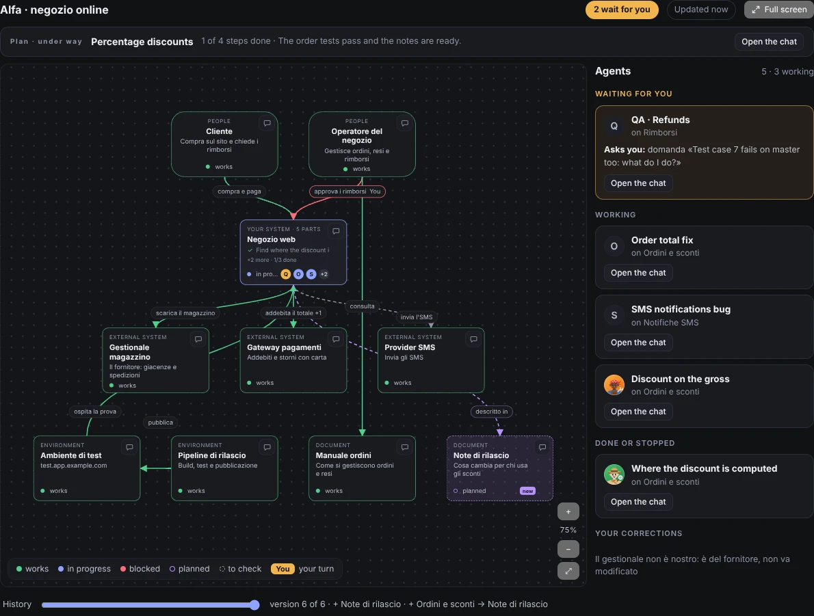</p>

### The brain map

Notes, chats, agents and tools as a 3D map you can spin, glowing along the links where the work is happening right now.

<p align="center">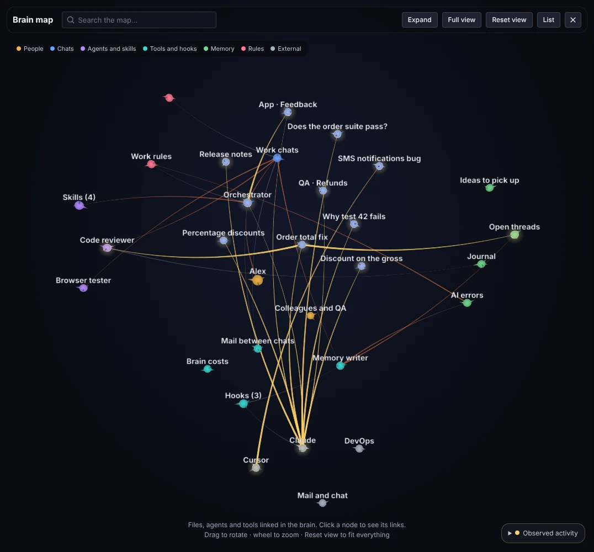</p>

### Trends, Log and costs

**Trends** puts the statistics on one page with tabs: **Costs** (where the money went, which chat's context is
getting heavy), **Quality**, **Learning** and **Usage**. The **Log** shows everything the app did, live: who chose
whom, what it cost, which answer was a duplicate. Both read local data and spend zero tokens.

<p align="center">
  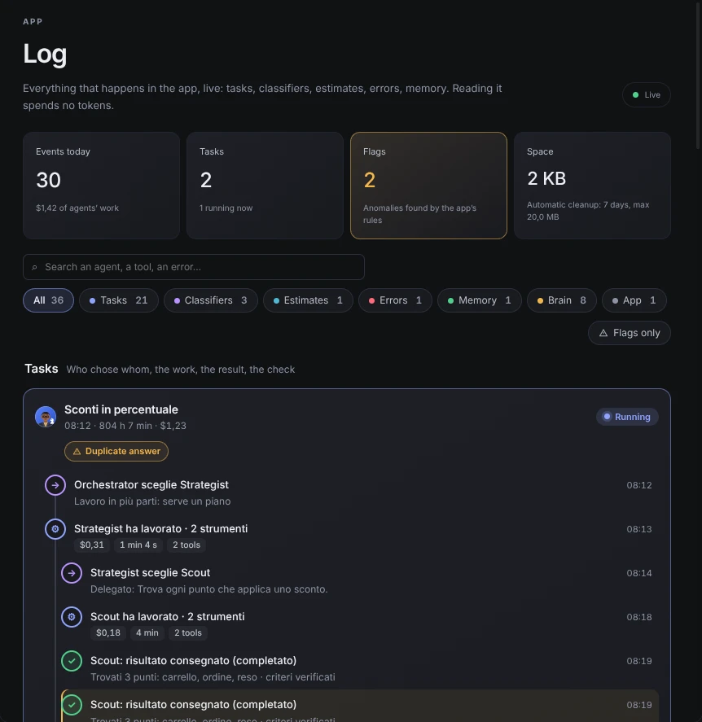
  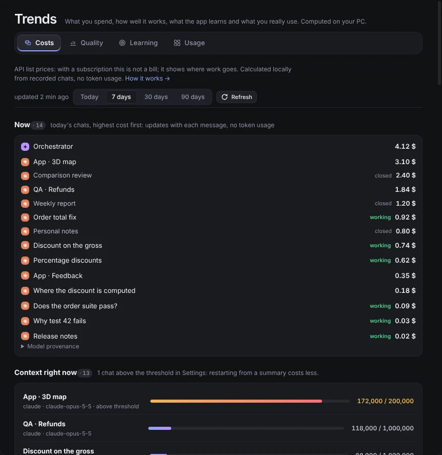
</p>

<p align="center">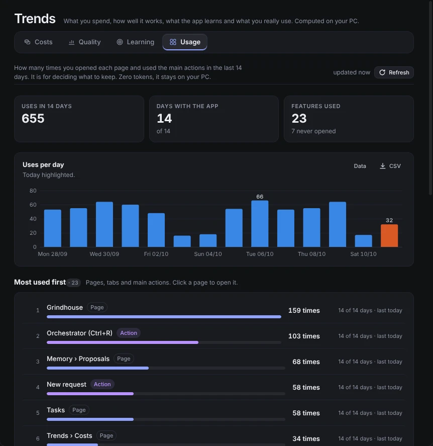</p>

## Learn

### A newspaper from your sources

**Learn** opens on the **News** tab: a newspaper of your own, by **editions**. An edition is any subject you follow
(AI for people who build agents, electric cars, your own field) with its sources, sections and key words; make one
by pasting links, from the ready-made AI edition, or ask the Orchestrator to find and try the sources for you.
**Refresh** reads them at zero tokens, merges the same story told by several sources, ranks the paper, and one AI pass
per edition writes a short summary and "why it matters to you". The front page holds a few stories only (7 by
default); "Less like this" drops one and its source weighs less. Three columns with keys (J/K, S save, U read, E learn
it, O open the source).

<p align="center">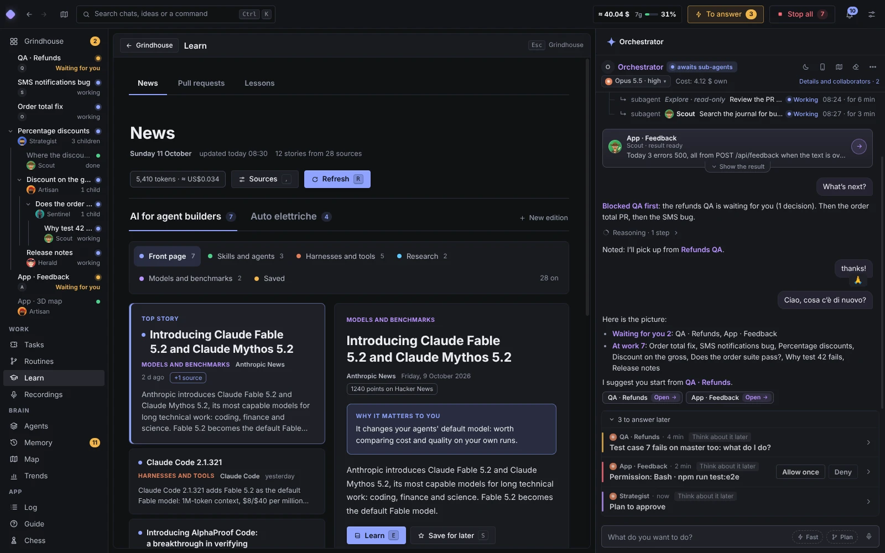</p>

### Understand what your agents built

Paste a PR link, a concept or a long text, drop in files or folders, and Learn explains it piece by piece on a
blackboard: flowcharts, sequence diagrams, mind maps, highlighted code and charts that grow as you go, out loud if you
like. By default a lesson is an **Explanation** with no questions at all; pick **Quiz** to be tested instead, with an
honest score and review cards.

<p align="center">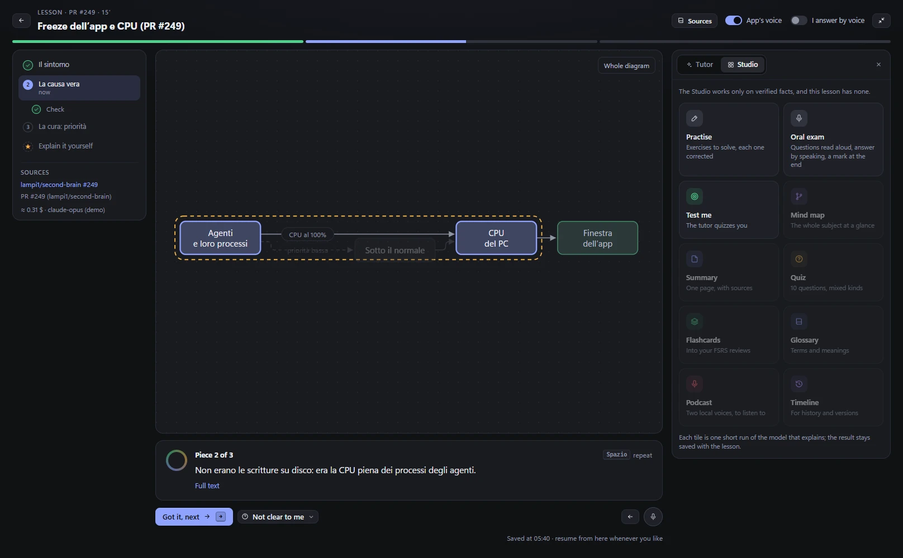</p>

## Voice, calls and the phone

- **Dictation.** Hit **Ctrl+M** and speak into the Orchestrator or Flash: it types, you send.
- **Voice conversation.** **Ctrl+Shift+Space** and just talk: the answer is read out loud while it is still being
  written. Talk over it and it stops and listens. A spoken "yes" or "no" counts as the click.
- **Recordings.** **Record call** grabs your mic and the PC's audio (Teams, Meet, whatever) and writes the transcript
  locally, "You" and "Others". Later you tell the Orchestrator "open a bug from this morning's call".
- **Telegram.** Settings → Phone links a private bot of yours: write or send a voice note from the phone and answer
  questions with a button.
- **Remote Control.** The phone icon on the Orchestrator turns on Claude Code Remote Control: open the link in the
  Claude app or a browser and keep going from there.

Parakeet or Whisper hears you and Piper speaks, all on your PC: no audio leaves it, and it costs nothing.

<p align="center">
  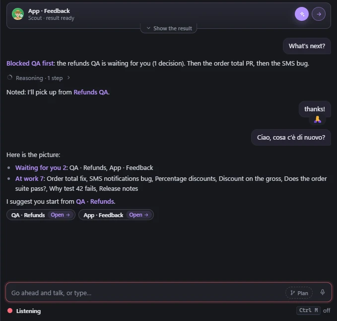
  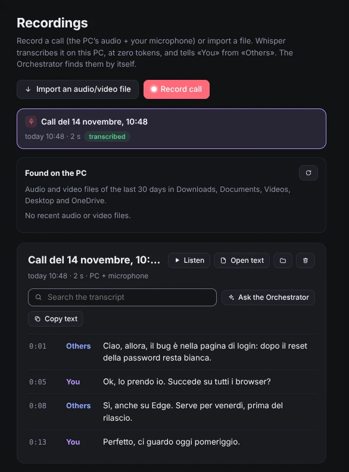
</p>

## Also on board

- **Emoji instead of essays.** Say "thanks" and you get a 🙏 on your message, not a paragraph. Any agent with nothing
  to add reacts instead of replying, on every engine, so those tokens go to work.
- **Connectors in one paste.** Paste a README's JSON, a command line or a URL and the MCP server is ready; switch it on
  per role. Remote servers log in with the MCP OAuth flow.
- **Settings that find themselves.** One page with a section list, search that highlights the matching row, instant
  save with Undo.
- **Routines on a schedule.** Write a request once and choose when (every day at a time, every few hours, once): the
  Orchestrator receives it at that time and does it with the agents. Or just tell the Orchestrator "every morning at 8".
- **Routines as packages, run from the terminal.** Prepare a routine package with the Orchestrator, export it, and run it
  anywhere with `routine run`, `watch` or `resume` ([packages/routine-runtime](packages/routine-runtime/README.md)).
- **Tasks.** The Task page lists your Azure DevOps work items and PRs, with builds, votes and QA results.
- **A guide inside.** Every concept of the app as a card in the **Guide**: how it works, an everyday analogy, the
  source files. **Discuss** sends the card to the Orchestrator.
- **Three languages.** The UI speaks Italian, English and German.
- **Just the brain.** The template works without the app: `node brain-template/install.mjs`.

## Documentation

| | |
|---|---|
| [AGENTS.md](AGENTS.md) | The map for AI agents working on this repository: commands and rules |
| [CONTRIBUTING.md](CONTRIBUTING.md) | From a fresh clone to a merged change |
| [docs/VISION.md](docs/VISION.md) | What the project wants to be |
| [docs/architecture.md](docs/architecture.md) | How the pieces fit |
| [docs/adr/](docs/adr/README.md) | Every decision, the ones in force first |
| [CHANGELOG.md](CHANGELOG.md) | What changed |
| [SECURITY.md](SECURITY.md) | How to report a vulnerability |

## Contributing

Issues and pull requests are welcome, from people and from their agents. Start with
[CONTRIBUTING.md](CONTRIBUTING.md); `npm run demo` gives you the whole app on fictional data, and
`npm run check:quick` is the gate of a branch.

Use the app at your own risk: agents run commands on your machine with the permissions you give them, so read what
they propose before you approve it. Check the Anthropic, OpenAI and Cursor terms before you use it with a
subscription.

## License

[MIT](LICENSE)
